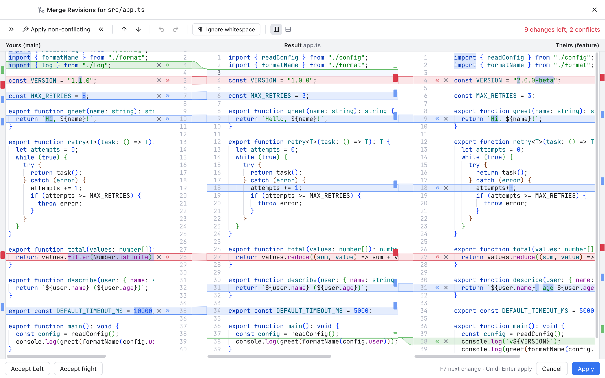
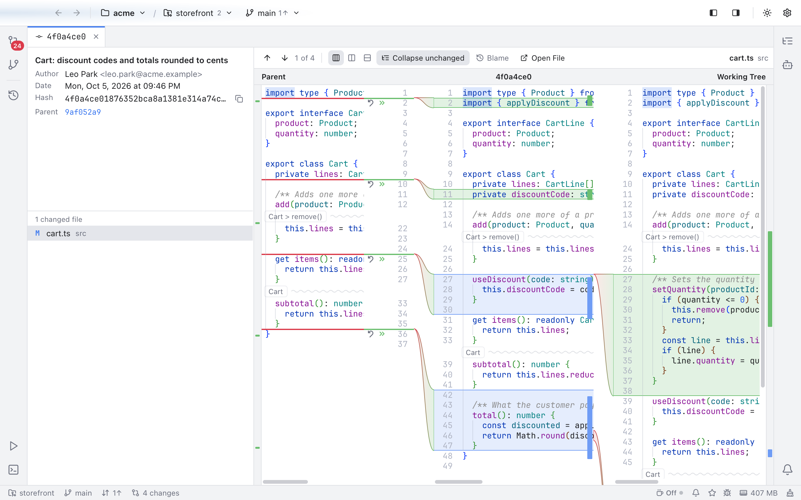

<p align="center"></p>

# Nibtree

A native desktop Git client with a 3-way merge tool, multi-folder workspaces, tabs, blame and history, and a place to run and watch AI coding agents side by side. Built with Rust (Tauri 2) and a small Svelte 5 UI running in the system web view, so it starts fast and stays light on memory.


- **[Download the latest release](https://github.com/shibbirweb/nibtree/releases)**: the desktop app for macOS (Apple Silicon and Intel), Windows 10 and 11, and Linux (x64)
- **In your browser**: `npx nibtree` ([npm](#in-your-browser-with-npm)), or [Docker](#in-docker) with `docker run` or `docker compose`
- **[User guide and developer docs](https://github.com/shibbirweb/nibtree/wiki)**
- **[Report a bug or request a feature](https://github.com/shibbirweb/nibtree/issues/new/choose)**

## Screenshots

<table>
  <tr>
    <td width="50%"><br><b>Merge tool</b>: Yours, Result and Theirs with per-change arrows</td>
    <td width="50%"><br><b>Conflicts in the editor</b>: Accept Current, Incoming or Both</td>
  </tr>
  <tr>
    <td><br><b>Log</b>: branch graph, tags and commit details</td>
    <td><br><b>Commit tabs</b>: a commit's diff in the whole editor area</td>
  </tr>
  <tr>
    <td><br><b>Changes</b>: grouped by repository, stage and commit</td>
    <td><br><b>Blame</b>: who changed each line, click to see the commit</td>
  </tr>
  <tr>
    <td><br><b>Workspaces</b>: many folders and repositories in one window</td>
    <td><br><b>Light and dark themes</b>, following the system by default</td>
  </tr>
  <tr>
    <td><br><b>AI agents</b>: run agents per worktree and see who is working or needs you</td>
    <td><br><b>AI usage</b>: each agent's limits and the time left until they reset</td>
  </tr>
</table>

Every feature has its own page with screenshots in the [wiki](https://github.com/shibbirweb/nibtree/wiki).

## Features

- **Workspaces**: open any folder, whether it is one repository, many (nested ones included) or no git at all (initialize one from the app). Add more folders to the same window, save the set to a `.nibtree-workspace` file, or open a `.code-workspace` file. Repositories you clone or create inside an open folder show up on their own, and a progress card shows while a big folder opens.
- **3-way merge tool**: Yours | Result | Theirs panes with connectors, per-change apply and ignore buttons, "apply both" for conflicts, one-click *Apply non-conflicting*, word-level highlights, synchronized scrolling, F7 navigation, full undo and an ignore-whitespace mode.
- **Conflicts made easy**: a Conflicts dialog to take Yours or Theirs for whole files (binary and deleted files too), inline *Accept Current / Incoming / Both* actions in the editor, and Continue, Abort or Skip for merge, rebase, cherry-pick and revert.
- **Native menu bar** with the Nibtree app menu (macOS), File, Edit, View, Code, Git, Window and Help menus, and **Help > Keyboard Shortcuts**, an in-app list of every shortcut.
- **Git menu**: Commit, Push and Pull dialogs, Update Project, Merge and Rebase dialogs with their options, **Interactive Rebase**, Reset HEAD, Branches, tags, patches, Manage Remotes, Clone, and Current File history, blame and compare views.
- **Changes**: staged and unstaged files grouped by repository, each with a branch picker, **Sync Changes** (or **Publish Branch** for a new branch) and a **...** menu of its own actions. Side-by-side diffs (resizable), stage or unstage whole files or single hunks, discard, commit, amend, Commit & Push, Commit & Sync and Commit (Amend), commit options (sign off, author, GPG, skip hooks) and Add to .gitignore.
- **Shelf, worktrees, submodules and Git LFS** from the Git menu, plus a **Git Console** that shows every git command the app runs (off by default).
- **GitHub**: sign in with a token kept in the system keychain or with the GitHub CLI, then Share Project on GitHub, Sync Fork, Create Gist, and open its pull request pages on GitHub.
- **Editor and tabs**: preview tabs (shown in italics until you edit or pin them), breadcrumbs, change markers in the gutter and on the scrollbar, a find and replace bar, Code menu commands, Render whitespace, line spacing, syntax highlighting, font ligatures and zoom with Ctrl or Cmd + mouse wheel.
- **Search Everywhere**: double Shift for files, classes, symbols and text in every folder, plus Replace in Files.
- **Markdown editor** with a live preview, mermaid diagrams, a formatting toolbar and a Rich Editor view you can type in.
- **Run AI agents**: the AI panel (the robot button in the right activity bar) lists every workspace folder and repository with its worktrees. Start Claude Code, Codex, Gemini CLI, OpenCode, Cursor CLI, GitHub Copilot CLI, Aider, Amp or Qwen Code (whichever are installed) in its own tab, with an optional first prompt. You choose once whether agents ask before acting or work on their own, and each agent's command, flags and arguments can be changed in Settings, so a renamed command needs no app update.
- **Monitor agents**: each agent shows whether it is working, needs you or is done, what it is working on and since when; a count shows how many need you, and an agent that finishes out of sight marks its tab. The status bar shows each agent's usage limits with the time left until they reset, the memory details list what every agent and terminal uses, and **Keep computer awake** can stop the screen from sleeping or locking while agents work.
- **Parallel tasks**: New Task turns a task name into its own branch and worktree, ready to run (`.env` files copied, `node_modules` linked), and can race up to five agents on the same task in separate worktrees. Finish Task closes the agents and removes the worktree and its branch, asking before any work is lost.
- **Integrated terminal** with several shells, terminals in editor tabs, and a **Scripts** tool window that runs npm, Composer, Make, Deno and just scripts with the right Node version, in a Run tab.
- **Blame**: inline blame for the current line and a blame gutter; click it to open that commit in the Log on the same line.
- **Log**: paged history with a branch graph, commit details and per-file diffs. Double-click a commit (or use *Open in Tab*) to read it full size in its own tab. Cherry-pick, revert, reset and checkout from the right-click menu.
- **Branches, tags, remotes and stashes**: checkout, create, rename, delete, merge and rebase from the sidebar or the Branches popup; fetch, pull and push with live progress; stash, apply, pop, drop and clear.
- **Back and Forward** across files, diffs and commits, like a browser.
- **37 color themes**, one for light and one for dark mode, following the system by default.
- **Settings** saved in `~/.nibtree`, header buttons that show or hide the left and right activity bars, a status bar with the app's memory use (plus an optional memory log for debugging), and update checks with a stable and a beta channel.
- **MCP server and command line tool** (off by default, local only) so AI tools such as Claude Code can use the app.
- **Works as `git mergetool`** (see below).

## Platforms

The desktop app runs on macOS, Windows and Linux with the same features (Linux has no memory readout yet). The [browser version](#in-your-browser-with-npm) runs on more platforms, [below](#browser-version-platforms). Each platform is built and tested on every pull request. Where the desktop app differs:

| | macOS | Windows | Linux |
| --- | --- | --- | --- |
| Download | Universal `.dmg` (Apple Silicon and Intel) | `-setup.exe` for 64-bit Windows 10 and 11, installs for your account without admin rights | `.AppImage` (any distribution) or `.deb` (Ubuntu, Debian), x64 |
| First launch | Not signed yet: right-click the app, Open | Not signed yet: SmartScreen, More info, Run anyway | AppImage: `chmod +x` first |
| Web view | WebKit (WKWebView) | Microsoft Edge WebView2 (the installer adds it if missing) | WebKitGTK |
| Menu bar | Top of the screen, with a Nibtree menu | Inside the window; Settings and Exit in File, About in Help | Inside the window, like Windows |
| Shortcuts | Cmd and Option | Ctrl and Alt; Navigation Bar is Alt+Home, tabs switch with Ctrl+PageDown and Ctrl+PageUp | Like Windows |
| Git menu keys (Commit, Update Project, Show Log) | Cmd+K, Cmd+T, Cmd+9 | None: Ctrl+K and Ctrl+T belong to the shell | None, like Windows |
| Terminal shells | Your login shell and those in `/etc/shells` | PowerShell 7, Windows PowerShell, Command Prompt and Git Bash | Your login shell and those in `/etc/shells` |
| Terminal copy and paste | Cmd+C, Cmd+V | Ctrl+Shift+C, Ctrl+Shift+V | Ctrl+Shift+C, Ctrl+Shift+V |
| Tools found on PATH | Read from your login shell (`~/.zprofile`) | The PATH Windows gives the app | Read from your login shell |
| Git sign-in | Your git setup (macOS keychain, SSH agent) | Your git setup (Git Credential Manager, SSH agent) | Your git setup (credential helper, SSH agent) |
| GitHub token | Keychain | Credential Manager | Keyring (GNOME Keyring or KWallet) |
| Deleted files | Trash | Recycle Bin | Trash |
| Settings folder | `~/.nibtree` | `C:\Users\<you>\.nibtree` | `~/.nibtree` |
| Command line tool | `nibtree` in the app, linked into `~/.local/bin` | `nibtree-cli.exe` next to the app, `nibtree.cmd` in WindowsApps | `nibtree` (on PATH from the `.deb`; linked into `~/.local/bin` from the AppImage) |
| Memory readout | Activity Monitor's Memory (physical footprint) | Task Manager's Memory (private working set) | Not yet |

### Browser version platforms

Only a small server runs on your machine (or in a container); any modern browser shows the app.

| | npm (`npx nibtree`) | Docker |
| --- | --- | --- |
| Runs on | macOS (Apple Silicon and Intel), Linux (x64 and Arm, glibc), Windows (x64 and Arm) | Any machine with Docker: `linux/amd64` and `linux/arm64` images |
| Needs | git, and Node.js 18 or newer (or Bun) | Docker; git, git-lfs, SSH and GnuPG are inside the image |
| Default port | 4300, moving on to the next free one when busy | 4410 |
| Settings folder | `~/.nibtree-browser` | `/home/nibtree/.nibtree-browser`, kept in the `nibtree-home` volume |
| Git sign-in | Your git setup | The git config and SSH keys you mount in |
| Newer version | `npx nibtree@latest` or `npx nibtree@next` | `docker pull` or `docker compose pull` |
| Clear Cache | Yes | Not yet (macOS only for now) | |
| Option as Meta in the terminal, Enter Full Screen | Yes | No | |
| PDF preview | Safari's built-in viewer | Microsoft Edge's built-in viewer | |
| Opening the app again | Brings the running app forward | Hands its folder to the running app | |

The user guide covers each difference where it matters ([Getting Started](https://github.com/shibbirweb/nibtree/wiki/Getting-Started) has the install steps); how the code handles them is in [Windows Support](https://github.com/shibbirweb/nibtree/wiki/Windows-Support) and [Linux Support](https://github.com/shibbirweb/nibtree/wiki/Linux-Support).

## Three ways to run it

The same app comes as a desktop app, as an npm package that opens it in your browser, and as a Docker image. The
browser versions keep their settings in `~/.nibtree-browser`, apart from the desktop app's `~/.nibtree`. Until
the first stable release is out, use the `next` lines below: they give the newest beta.

### Desktop app

Download it from [Releases](https://github.com/shibbirweb/nibtree/releases): the `.dmg` for macOS (Apple Silicon and Intel), `-setup.exe` for Windows 10 and 11, or the `.AppImage` or `.deb` for Linux. Betas are marked as pre-releases; the app tells you about updates on your channel (Settings).

### In your browser with npm

Needs git and [Node.js](https://nodejs.org) 18 or newer (with [Bun](https://bun.sh), use `bunx nibtree`). Run it in the folder you want to open:

```sh
npx nibtree                    # the newest stable release, opening the current folder
npx nibtree ~/code/app         # another folder (or several)
npx nibtree@next               # the newest beta
npx nibtree@0.1.0-beta.13      # exactly that version
npm install -g nibtree         # install it once, then run `nibtree`
```

It starts a small server on this machine, prints an address with an access token and opens it in your browser. Keep the terminal open while you work; Ctrl+C stops it.

| Option | What it does |
| --- | --- |
| `--port <n>` | Port to listen on (default 4300; a busy port moves on to the next free one, `0` lets the system pick) |
| `--strict-port` | Stop instead of moving on when the port is busy |
| `--host <address>` | Where to listen (default `127.0.0.1`; `0.0.0.0` lets other machines in) |
| `--token <value>` | A fixed access token instead of a new random one (also `NIBTREE_TOKEN`) |
| `--no-open` | Print the address without opening a browser |
| `--base-path <path>` | Serve under a path, behind a reverse proxy (for example `/nibtree/`) |
| `--public-url <url>` | The address to print when a proxy maps another one |

Every page needs the token, also on your own machine. With `--host 0.0.0.0`, anyone who can reach the address and has the token can read and change your files and run commands, so use it only on networks you trust. Details: [Browser Version Packages](https://github.com/shibbirweb/nibtree/wiki/Browser-Version-Packages).

### In Docker

The image has git, git-lfs, SSH and GnuPG inside and listens on port 4410. It is on GitHub's registry and Docker Hub:

```sh
docker run --rm -p 4410:4410 \
  -v "$PWD:/workspace" \
  -v nibtree-home:/home/nibtree \
  -e NIBTREE_TOKEN=pick-a-secret \
  ghcr.io/shibbirweb/nibtree:next        # or shibbirweb/nibtree:next from Docker Hub
```

Then open `http://localhost:4410/?token=pick-a-secret`.

#### With Docker Compose

The same with Docker Compose, listening only on this machine. Save this as `compose.yaml` in the folder you want to open (it is [`docker/compose.yaml`](docker/compose.yaml), which explains each line):

```yaml
services:
  nibtree:
    image: ${NIBTREE_IMAGE:-ghcr.io/shibbirweb/nibtree:${NIBTREE_TAG:-next}}
    ports:
      - "127.0.0.1:${NIBTREE_OUTSIDE_PORT:-4410}:4410"
    environment:
      NIBTREE_TOKEN: ${NIBTREE_TOKEN:-}
      NIBTREE_PUBLIC_URL: http://localhost:${NIBTREE_OUTSIDE_PORT:-4410}
    user: ${NIBTREE_USER:-1000:1000}
    volumes:
      - ${NIBTREE_WORKSPACE:-.}:/workspace
      - nibtree-home:/home/nibtree
      # - ~/.gitconfig:/home/nibtree/.gitconfig:ro
      # - ~/.ssh:/home/nibtree/.ssh:ro
    restart: unless-stopped

volumes:
  nibtree-home:
```

Then:

```sh
NIBTREE_TOKEN=pick-a-secret docker compose up -d   # start it in the background
docker compose logs nibtree                        # the address, also with a random token when none is set
docker compose pull && docker compose up -d        # move to a newer version
docker compose down                                # stop it (settings stay in the nibtree-home volume)
```

| Variable | What it does |
| --- | --- |
| `NIBTREE_TOKEN` | The access token (default: a new random one on each start) |
| `NIBTREE_TAG` | The image tag (default `next`) |
| `NIBTREE_WORKSPACE` | The folder to open (default: the one with `compose.yaml`) |
| `NIBTREE_OUTSIDE_PORT` | The port on this machine (default 4410) |
| `NIBTREE_USER` | On Linux, `"$(id -u):$(id -g)"`, so files it writes belong to you |

Uncomment its two `.gitconfig` and `.ssh` lines to use your git identity and SSH keys inside.

#### Tags and options

| Tag | Gets |
| --- | --- |
| `latest` | the newest stable release |
| `next` | the newest beta |
| `0.1.0-beta.13` | exactly that version |

With `docker run`:

- `/workspace` is the folder it opens; the `nibtree-home` volume keeps settings between runs.
- Add `-v ~/.gitconfig:/home/nibtree/.gitconfig:ro -v ~/.ssh:/home/nibtree/.ssh:ro` for your git identity and SSH keys.
- On Linux add `--user "$(id -u):$(id -g)"`, so files it writes belong to you.
- Another outside port, such as `-p 9000:4410`, needs `-e NIBTREE_PUBLIC_URL=http://localhost:9000` so the printed address is right.

Details: [Docker Image](https://github.com/shibbirweb/nibtree/wiki/Docker-Image).

## How it works

```
Svelte UI (system WKWebView)  --invoke/events/channels-->  Rust (Tauri commands)
                                                    git2 (libgit2): fast reads (status, index stages, diff, log, refs)
                                                    git CLI: every write, so hooks, credentials, signing and config behave as in the terminal
                                                    merge engine: 3-way chunking with imara-diff (histogram)
                                                    watcher: debounced file events -> "repo-changed"
                                                    services: terminals (PTY), AI agents, search indexes, scripts, GitHub, MCP server
```

Memory is kept low by design:
- No bundled browser engine; the OS web view is used.
- Rust opens the repository per command and keeps no file contents between calls.
- Diffs load only for the selected file; CodeMirror renders only the visible lines; the log is paged and virtualized.
- Language grammars and big libraries (xterm.js, the Markdown preview, mermaid, color themes) load on first use; features that are off, like the Git Console and the MCP server, cost nothing.
- The merge tool is an overlay in the main window, not a second web view.
- Release builds use `opt-level = "s"`, LTO, `panic = "abort"` and stripped symbols.

## Development

Requirements: Rust (stable), [Bun](https://bun.sh), and git. Bun runs every frontend tool on its own runtime (`bun --bun`), so no Node.js install is needed.

```sh
bun install          # frontend dependencies
bun tauri dev        # run the app with hot reload
bun run check        # svelte-check / TypeScript
bun run test         # frontend unit tests (Vitest)
cd src-tauri && cargo test --workspace   # Rust unit and git integration tests
bun tauri build      # release .app and .dmg in src-tauri/target/release/bundle
bun run ui           # the UI library showcase at http://localhost:1430
```

New UI is built in the component library first (`ui/web`), with the design tokens in `ui/design-tokens` that every
platform shares; see `ui/web/COMPONENTS.md`.

Open a repository from the welcome screen, or pass it on the command line:

```sh
src-tauri/target/release/nibtree /path/to/repo
```

To try the merge tool on a throwaway repository full of conflicts:

```sh
scripts/make-conflict-repo.sh /tmp/conflict-demo
```

To try a folder holding several repositories (one nested, one mid-merge, one clean, plus a plain folder):

```sh
scripts/make-workspace-demo.sh /tmp/workspace-demo
```

## Documentation

The [wiki](https://github.com/shibbirweb/nibtree/wiki) has a user guide with screenshots of every feature and developer docs with a chapter per feature (why it exists, how it works, the bugs we fixed). Its source is `docs/wiki/`: edit it there, never in the wiki. CI checks it with `bun scripts/build-wiki.ts --check`, and `.github/workflows/wiki.yml` publishes it when `master` changes. Screenshots are regenerated with `bun scripts/screenshots.ts` (see `docs/wiki/developer/Docs-and-Screenshots.md`).

## Continuous integration and releases

- **Branches**: work merges into `develop` (the beta line) by pull request; `master` is stable.
- **CI** (`.github/workflows/ci.yml`) runs on every push to `develop` and `master` and every pull request, on macOS: `bun scripts/version.ts check`, `bun run check`, `bun run test`, `bun scripts/build-wiki.ts --check`, `cargo test` and `cargo clippy --all-targets -- -D warnings`. The checks also run on Windows, and the Rust ones on Linux. Every pull request also builds the macOS app, the Windows installer and the Linux packages (`macos-app.yml`, `windows-installer.yml`, `linux-packages.yml`) and keeps them as downloads.
- **Browser version** (`.github/workflows/browser.yml`) builds `nibtree-browser` on macOS, Linux and Windows (x64 and Arm each), runs its tests, smoke tests its npm packages and its Docker image (amd64 and arm64); every release publishes them to npm, ghcr.io and Docker Hub.
- **Versions and notes**: the version lives in `src-tauri/Cargo.toml` and only the release workflows move it. Release notes come from `CHANGELOG.md`, so write each change under `## [Unreleased]` in the same pull request.
- **Releases** are automated: the "Beta release" and "Stable release" workflows open a release pull request; once it is merged (and, for a stable release, the `develop` to `master` pull request too), the GitHub release is published and the macOS app is built. Builds are unsigned unless the `APPLE_*` secrets are set.

The [Releases and CI](https://github.com/shibbirweb/nibtree/wiki/Releases-and-CI) page has the full flow, every workflow and the one-time repository setup; [Updates](https://github.com/shibbirweb/nibtree/wiki/Updates) explains the stable and beta channels.

## Using it as `git mergetool`

After building, point git at the binary inside the app bundle:

```sh
APP="/Applications/Nibtree.app/Contents/MacOS/nibtree"
git config --global mergetool.nibtree.cmd "\"$APP\" merge \"\$BASE\" \"\$LOCAL\" \"\$REMOTE\" \"\$MERGED\""
git config --global mergetool.nibtree.trustExitCode true
git config --global merge.tool nibtree
```

Then `git mergetool` opens each conflicted file. **Apply** (or Cmd+Enter) writes the result and exits with status 0, so git marks the file resolved. **Cancel**, Esc or closing the window asks first if you changed the result, then exits with status 1 and the file stays unresolved. Cmd+Q quits with status 1 without asking.

## Settings

Open **Settings** with the gear button in the header, **Nibtree > Settings...** or **Cmd+,**. Its sections are Appearance, Editor, Git, Layout, Terminal, AI, Keyboard Shortcuts, GitHub, Automation, Updates, Settings Files and About. Changes apply immediately and are saved in a folder in your home directory:

```
~/.nibtree/
  settings.json   preferences (theme and color themes, fonts, editor, Git, terminal, AI, automation); safe to edit by hand
  state.json      recent folders, active repository per folder, panel layout and sizes
  github.json     the signed-in GitHub login (the token itself stays in the system keychain)
  mcp.json        the MCP server's secret token, plus its port while it runs
  logs/memory.log the debug memory log, only while it is on
```

The folder is created the first time a setting is saved. If `settings.json` or `state.json` contains invalid JSON, the app uses defaults for that file only, shows the error in Settings, and never overwrites it: fix it and click **Try Again**, or **Reset** it. The [Settings page](https://github.com/shibbirweb/nibtree/wiki/Settings) lists every setting.

## Keyboard shortcuts

A few to start with (macOS keys; Help > Keyboard Shortcuts lists them all):

| Key | Action |
| --- | --- |
| Shift Shift | Search Everywhere |
| Cmd+P / Cmd+O / Option+Cmd+O | Go to File / Class / Symbol |
| Shift+Cmd+F / Shift+Cmd+R | Find in Files / Replace in Files |
| Cmd+F / Cmd+R | Find / Replace in the editor |
| Cmd+S / Option+Cmd+S | Save / Save All |
| Cmd+K / Cmd+T | Commit / Update Project |
| Cmd+9 | Show Git Log |
| Ctrl+` / Ctrl+Shift+` | Show or hide the terminal / New terminal |
| Cmd+B / Option+Cmd+B | Files panel / Sidebar |
| Cmd+, | Settings |

In the merge tool:

| Key | Action |
| --- | --- |
| F7 / Shift+F7 | Next / previous unresolved change |
| Cmd+Z / Shift+Cmd+Z | Undo / redo in the result (also restores chunk state) |
| Cmd+Enter | Apply (save the result and mark resolved), from any pane |
| Esc | Cancel (asks first if you changed the result) |

Every shortcut is on the [Keyboard Shortcuts page](https://github.com/shibbirweb/nibtree/wiki/Keyboard-Shortcuts).

## Project layout

```
src/                     Svelte UI
  lib/merge/             3-way merge view: model.ts (pure logic), extensions.ts (CodeMirror), MergeEditor.svelte
  lib/diff/              2-way diff view
  lib/log/               commit graph, commit details and commit tabs
  lib/editor/            CodeMirror setup, blame, conflict and change markers, find bar, editor commands
  lib/menu/, lib/help/   native menu bar and the Keyboard Shortcuts window
  lib/terminal/          integrated terminal and the Run tab
  lib/ai/                AI panel, agents, tasks, usage and keep awake
  lib/scripts/           Scripts tool window
  lib/search/            Search Everywhere and Replace in Files
  lib/markdown/          Markdown preview and rich editor
  lib/themes/            color themes
  lib/mcp/               UI side of the MCP server
  lib/stores/            app state: repositories, tabs, settings, navigation
  lib/views/             workspace, header, sidebars, changes, files, Git menu dialogs, GitHub, settings
  lib/update/            update check and What's New
  lib/api.ts, types.ts   typed bridge to the Rust commands
src-tauri/src/
  merge/                 3-way merge engine
  git/                   git2 readers and the git CLI runner
  commands/              Tauri commands
  terminal.rs, run_process.rs   terminals and script runs in pseudo terminals
  ai_usage/, keep_awake.rs      AI agents' usage limits and keeping the computer awake
  file_search.rs, symbols/, text_search/   Search Everywhere and Replace in Files
  scripts/, node_versions.rs    project scripts and installed Node versions
  github/, mcp/          GitHub account and the MCP server with its command line tool
  watcher.rs             repository file watcher
docs/wiki/               the wiki: user guide, developer docs and screenshots
scripts/                 versioning, wiki build, screenshots and demo repositories
```

The [Project Layout page](https://github.com/shibbirweb/nibtree/wiki/Project-Layout) explains every folder.

## License

[MIT](LICENSE) © 2026 [MD. Shibbir Ahmed](https://github.com/shibbirweb)
