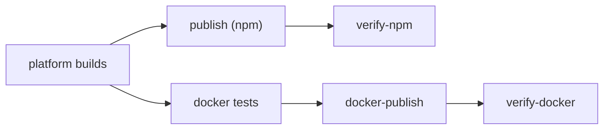
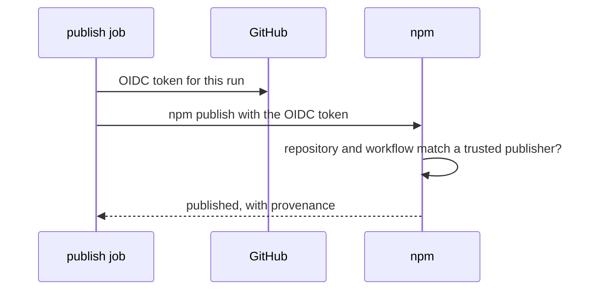

# Browser Release Checks

A release of the browser version lands in four places: the GitHub release (with the desktop app), npm, ghcr.io
and Docker Hub. They are separate services, so no release can succeed or fail on all four at once. This page
explains how we make a half-finished release unlikely, loud when it happens, and easy to finish. The packages and
the image themselves are in [Browser Version Packages](Browser-Version-Packages.md) and
[Docker Image](Docker-Image.md).

## Before a release: the rehearsal

`.github/workflows/browser-rehearsal.yml` runs on every push to `develop`, the branch betas are cut from. It
calls `browser.yml` with `publish: true` and `dry_run: true`, so it walks the real release path:

1. release-mode programs (`--release`, with LTO and `panic = "abort"`) on all six platforms, each smoke tested
   with Bun and Node;
2. the Docker image on amd64 and arm64, each smoke tested in a container;
3. `bun scripts/npm-package.ts publish --dry-run` over every tarball (`npm publish --dry-run`): the registry
   check, the dist-tag and the order, with nothing uploaded;
4. the two-architecture Buildx build with every tag, without `--push`.

A newer push cancels an older rehearsal. Run workflow starts one by hand.

## During a release: no quiet skips

A release fails when `DOCKERHUB_USERNAME` or `DOCKERHUB_TOKEN` is missing, or when npm turns down the sign-in
below. Earlier, a missing secret only printed a warning: the run stayed green while nothing was published, which
is the worst kind of failure because nobody notices it.

npm and Docker are separate jobs, so one can fail while the other succeeds. The npm side publishes the platform
packages first and the launcher last: if anything fails in between, `nibtree@<version>` does not exist, so nobody
can install a launcher that points at a missing program.

## Signing in to npm: trusted publishing

npm trusts this repository's release workflows directly, so publishing needs no long-lived token. The publish job
asks GitHub for a short-lived OIDC token (an identity card that says which repository and workflow is running)
and npm swaps it for a one-time publish token. npm then also records provenance: the commit and the workflow
that built each package, shown on its npm page.

- **Which workflow npm sees.** For a called workflow, npm checks the one that started the run, not the one with
  the publish step. Betas start in `beta-publish.yml` and stable releases in `stable-publish.yml`, so each
  package lists both as trusted publishers.
- **`id-token: write` on every level.** A called job gets no more than its caller grants, so `beta-publish.yml`,
  `stable-publish.yml`, `release.yml` and `browser-rehearsal.yml` all grant it, as the publish job asks for it.
- **The npm CLI, only here.** `bun publish` cannot sign in this way, so the publish job installs Node 24 and
  npm 11, which trusted publishing needs. Everything else stays on Bun.
- **No npm token.** The repository has no `NPM_TOKEN` secret: nothing long-lived can leak, and a publisher that
  does not match fails the release instead of falling back to another sign-in.

## After a release: verify jobs

`release.yml` runs `browser-verify.yml` after the browser job, also when that job failed halfway, so whatever did
get published is checked. Run workflow starts it by hand for any tag. `scripts/release-verify.ts` checks what
people actually get, retrying for up to half an hour while the registries catch up:

- **`verify-npm`**, on Linux, macOS and Windows: npm lists the launcher and all six platform packages at the
  version, the `next` or `latest` tag points at it, and `npx nibtree@<version> --version` and
  `npx nibtree@<tag> --version` both print it;
- **`verify-docker`**: in both registries the version has `linux/amd64` and `linux/arm64`, and `docker run` of
  the version and of its moving tag prints it. It signs in to ghcr.io, because a new package there starts private.

## When a release breaks halfway

Open the release run in Actions and choose **Re-run failed jobs**. It is safe:

- `npm-package.ts publish` skips every version npm already has, so it only uploads what is missing;
- pushing the same Docker tags again stores the same image;
- the verify jobs run again after it.

If the fix needs a code change, it goes into the next release: a published npm version cannot be replaced.

## Where the code lives

| File | What it does |
| --- | --- |
| `.github/workflows/browser-rehearsal.yml` | the rehearsal on `develop` |
| `.github/workflows/browser.yml` | `dry_run`, the secret checks and the npm sign-in |
| `.github/workflows/browser-verify.yml` | `verify-npm` and `verify-docker`, run by `release.yml` (or by hand for a tag) |
| `scripts/release-verify.ts` | the checks after publishing |
| `scripts/dockerImage.ts` | `imagePlatforms`, read from the image index (tested) |

## Design decisions

**Rehearse on `develop`, not on every pull request.** Release builds on six platforms take about half an hour.
`develop` is where every beta starts, so a rehearsal there runs before any release can, while pull requests stay
on the faster debug builds.

**Fail on a missing secret.** A loud failure can be fixed with a rerun; a silent skip is found by users.

**Check from the outside.** The verify jobs use `npx` and `docker pull` like everyone else, so they also catch a
package that was published but cannot be installed.

## Bugs we fixed

**The first rehearsal on `develop` failed at Publish to npm.** `bun publish --dry-run` stopped with "missing
authentication", though a dry run sends nothing. The rehearsal had no `NPM_TOKEN` on purpose, so it cannot upload
by mistake. `scripts/npm-package.ts` now gives a dry run a placeholder token when there is no real one: bun is
happy, and a placeholder could not publish even if the dry-run flag were lost. Since then npm publishes instead of
bun (trusted publishing), and `npm publish --dry-run` needs no token, so the placeholder is gone.

**The beta.14 npm checks failed, though every package was on npm.** `npm publish` returned at 02:23, but npm
listed the platform packages two or three minutes later and the launcher after 11 minutes, while each check gave up
after five. npm processes a new version in the background, longer with provenance. The checks now share one
half-hour limit and try every 30 seconds: a slow registry costs only waiting, and a release that never shows up
still fails.
