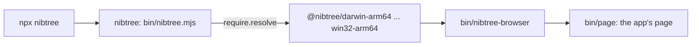

# Browser Version Packages

The browser version runs the whole app in a browser tab, served by a small program on your machine
(`nibtree-browser`, in `src-tauri/browser`). People install it from npm with `npx nibtree`. This page explains the
packages, how CI tests them on every platform, and how each release publishes them. The Docker image is built
from the same packages: see [Docker Image](Docker-Image.md).

## Why we need it

npm is where developers already get command line tools, and `npx` runs one without installing anything first.
But `nibtree-browser` is a native Rust program, a different file for each operating system and processor. npm has
no built-in way to ship one package per platform, so we use the pattern esbuild and others use: one small launcher
package and one optional package per platform.

## The packages

- **`nibtree`** (`npm/nibtree`) holds only the launcher, `bin/nibtree.mjs`. It lists every platform package as an
  optional dependency, pinned to its own version.
- **`@nibtree/<os>-<cpu>`**, six of them: `darwin-arm64`, `darwin-x64`, `linux-x64`, `linux-arm64`, `win32-x64` and
  `win32-arm64`. Each one sets `os` and `cpu` (and `libc: glibc` on Linux), so the package manager installs only
  the one that fits. It holds the program in `bin/` and the built page next to it in `bin/page`.

The launcher finds this machine's package with `require.resolve`, starts the program with the same arguments and
passes Ctrl+C and other signals on. When the program ends by a signal, the launcher ends by the same signal. If no
package fits, it says so plainly. `NIBTREE_BINARY` runs another build instead, for development.

The program looks for its page in `--assets`, then in `page` next to itself, then in this checkout's `build/`. So a
platform package works on its own, without the launcher.

## CI on every platform: `browser.yml`

`.github/workflows/browser.yml` runs on every pull request and every push to `master`, on six runners:
`macos-latest` (Apple silicon), `macos-15-intel`, `ubuntu-22.04`, `ubuntu-22.04-arm`, `windows-latest` and
`windows-11-arm`. Each one:

1. builds the page (`bun run build`) and runs the browser version's page tests;
2. runs its Rust tests: `cargo test -p nibtree-browser` and the app crate's `browser::` and `commands::browse::`;
3. builds `nibtree-browser` and packs both packages with `bun scripts/npm-package.ts pack`;
4. runs `scripts/browser-smoke.ts` twice, with Bun and with Node.

The smoke test unpacks the tarballs into a fresh `node_modules`, as a package manager would, and starts the
launcher on a new repository with a new home folder. It checks `--version`, that a page without the token gets
401, that the token becomes a cookie, the page, a WebSocket hello, `discover_repositories`, `get_status`, an error
from a desktop-only command, and that settings land in `~/.nibtree-browser` and never in `~/.nibtree`.

## Publishing with each release

`release.yml` has a `browser` job that calls `browser.yml` with `publish: true` for every beta and stable release. The
programs are then built in release mode, smoke tested, and kept as artifacts. A last job publishes them with
`bun scripts/npm-package.ts publish`:

- platform packages first, the launcher last, so the launcher never points at a missing package;
- betas under the `next` tag (`npx nibtree@next`), stable versions under `latest` (`npx nibtree`);
- a version that is already on npm is skipped, so rerunning a release is safe;
- npm's trusted publishing signs in, so each version shows its provenance on npm
  ([Browser Release Checks](Browser-Release-Checks.md)).

Every push to `develop` rehearses all of this without uploading, and after a release `verify-npm` installs what
npm serves on Linux, macOS and Windows. See [Browser Release Checks](Browser-Release-Checks.md).

Setup, once: create the free `nibtree` organization on npmjs.com (it owns the `@nibtree` scope), and on each of
the seven packages add the trusted publishers `beta-publish.yml` and `stable-publish.yml` of this repository.

## Where the code lives

| File | What it does |
| --- | --- |
| `npm/nibtree/bin/nibtree.mjs` | the launcher |
| `npm/nibtree/lib/platforms.mjs` | the six platforms: Node's names, the Rust target and the package name |
| `scripts/npmPackages.ts` | package manifests, the dist-tag and the publish order (tested) |
| `scripts/npm-package.ts` | `pack` and `publish` |
| `scripts/tarball.ts` | reads `.tgz` files without the `tar` program (tested) |
| `scripts/browser-smoke.ts` | the smoke test |
| `src-tauri/browser/src/assets.rs` | where the program finds its page |
| `src-tauri/browser/build.rs` | links the C runtime on Windows |
| `src-tauri/Cargo.toml` | the `desktop` feature |

## Design decisions

**The page in each platform package.** One copy in the launcher would be smaller to publish, but then the program
would only work through the launcher. Each user downloads only one platform package, so the size is the same for them.

**Bun packs, npm publishes.** The repository uses Bun, but `bun publish` has no trusted publishing, so the
publish job alone runs `npm publish` on the tarballs Bun packed: the exact files the smoke test checked. Node is
otherwise installed in CI only to run the launcher the way `npx` does.

**Our own tarball reader.** On Windows runners, Git Bash's GNU `tar` reads `C:\...` as a remote host name. Reading
the tarball in TypeScript works the same everywhere.

**The version everywhere.** `bun scripts/version.ts` writes the version into `npm/nibtree/package.json` and its
pins, and `check` fails if they drift ([Versioning and Changelog](Versioning-and-Changelog.md)).

**No Tauri in the program.** The app crate's `desktop` feature (on by default) holds everything Tauri: windows,
menus, the preview scheme, the MCP window host and the Tauri side of every command (the `#[crate::command]` macro
puts it behind `cfg(feature = "desktop")`). `nibtree-browser` depends on the app crate with
`default-features = false`, so it links no WebView: Linux needs no WebKitGTK, and the program is smaller.

## Bugs we fixed

**Windows CI could not link `nibtree-browser`.** `cargo test --workspace` on Windows failed with `memcpy`,
`malloc` and 100 more unresolved symbols, after `msvcrt.lib : warning LNK4003: invalid library format`. In a
workspace build the app crate has `desktop` on, so tauri-build runs: it writes an empty `msvcrt.lib` to link the
C runtime statically, and puts its folder on the library path of everything that links the app crate, but passes
its matching link arguments to the app's own programs only. `src-tauri/browser/build.rs` now passes the same
arguments, so `nibtree-browser` links the C runtime the way the desktop app does, with or without that file. As a
bonus, it needs no Visual C++ redistributable.

## Limits for now

- Linux packages need glibc; Alpine and other musl systems are not supported yet.

## Keeping in sync

Adding a platform means a row in `platforms.mjs`, a matrix entry in `browser.yml` and a pin in
`npm/nibtree/package.json` (`bun scripts/version.ts set` writes it). `scripts/npmPackages.test.ts` fails when the
pins and the platform list disagree. See also [Releases and CI](Releases-and-CI.md).
