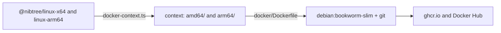

# Docker Image

The browser version also ships as a Docker image, so it runs on a server or any machine with Docker, without
installing Node or the program. The image is `ghcr.io/shibbirweb/nibtree` (and `shibbirweb/nibtree` on Docker
Hub). This page explains how it is built, tested and published. The npm side is in
[Browser Version Packages](Browser-Version-Packages.md).

## Running it

```sh
docker run --rm -p 4410:4410 \
  -v "$PWD:/workspace" \
  -v nibtree-home:/home/nibtree \
  -e NIBTREE_TOKEN=pick-a-secret \
  ghcr.io/shibbirweb/nibtree
```

Then open `http://localhost:4410/?token=pick-a-secret`. Without `NIBTREE_TOKEN` the server makes a random token
and prints the address in the container's log (`docker logs`).

- **Port 4410** is the image's own port. The npm version starts at 4300 and never moves on to 4410, so both can
  run on one machine. With another outside port (`-p 9000:4410`), set `NIBTREE_PUBLIC_URL=http://localhost:9000`
  so the printed address is right.
- **`/workspace`** is the folder the app opens. Pass another path inside the container as the command to open
  that one instead.
- **`/home/nibtree`** holds the settings (`~/.nibtree-browser`) and git's config. A named volume keeps them.
- **Your identity and keys:** mount them read-only, for example
  `-v ~/.gitconfig:/home/nibtree/.gitconfig:ro -v ~/.ssh:/home/nibtree/.ssh:ro`.
- **File owners:** on Linux add `--user "$(id -u):$(id -g)"`, so files the app writes belong to you.

## What is inside



`docker/Dockerfile` starts from `debian:bookworm-slim` and adds what the app needs to work like it does in a
terminal: `git` (every write goes through the git command), `git-lfs`, `openssh-client` for SSH remotes,
`gnupg` for signed commits, `ca-certificates` for HTTPS and `bash` for the built-in terminal. `tini` is the
first process: it passes `docker stop` on to the server and cleans up the terminals' shells.

The program and its page are not compiled in Docker. `bun scripts/docker-context.ts` unpacks the Linux npm
packages that CI already built and tested into `amd64/` and `arm64/`, and the Dockerfile copies the one for
its architecture. So the image runs the very same files as `npx nibtree` on Linux.

The image sets `NIBTREE_HOST=0.0.0.0`, `NIBTREE_PORT=4410` and `NIBTREE_NO_OPEN=1`. The program reads these
`NIBTREE_*` variables as defaults for its options, and options on the command line still win. It runs as the
user `nibtree` (uid 1000), and the system git config marks every folder as safe, because a mounted folder
usually belongs to the host's user.

## Tests in CI

`.github/workflows/browser.yml` has a `docker` job on `ubuntu-22.04` (amd64) and `ubuntu-22.04-arm` (arm64).
Each builds the image from its platform's package and runs `bun scripts/browser-smoke.ts --docker <image>`:

1. `--version` through the image's entry point;
2. `git`, `git-lfs`, `ssh`, `gpg` and `bash` are in the image;
3. a container as the current user, with a new repository on `/workspace`, a new home folder on
   `/home/nibtree`, a random outside port and `NIBTREE_PUBLIC_URL`; the printed address must be that one;
4. the same checks as the npm smoke test: the token, the page, the socket, `get_status`, a commit through the
   git command, and settings in `~/.nibtree-browser`;
5. `docker stop` must end it in under 8 seconds, which shows `tini` passed the signal on.

## Publishing

For a release (`publish: true`), `docker-publish` builds both architectures with Buildx and pushes them as one
image. QEMU only runs the image's `apt-get` for arm64: the programs are already built. The tags come from
`scripts/dockerImage.ts`: the exact version, plus `next` for a beta or `latest` for a stable release, the same as
on npm.

- **ghcr.io** uses the workflow's built-in token, so it needs no secret, but every caller must grant
  `packages: write` (`release.yml`, `beta-publish.yml` and `stable-publish.yml` do). The first push creates
  the package as private: open it under the account's Packages, Package settings, and make it public once.
- **Docker Hub** needs the secrets `DOCKERHUB_USERNAME` and `DOCKERHUB_TOKEN` (an access token with read and
  write). Without them the job prints a warning and pushes to ghcr.io only.

## Where the code lives

| File | What it does |
| --- | --- |
| `docker/Dockerfile` | the image |
| `scripts/docker-context.ts` | the build context from the Linux packages |
| `scripts/dockerImage.ts`, `scripts/docker-tags.ts` | architectures and tags (tested) |
| `scripts/browser-smoke.ts` | the smoke test, `--docker` mode |
| `src-tauri/browser/src/options.rs` | the `NIBTREE_*` defaults, `--public-url` and port 4410 |

## Design decisions

**From the npm packages, not a build in Docker.** Compiling Rust for arm64 under QEMU takes far longer, and two
builds could differ. Reusing the tested packages keeps one program for both.

**Debian, not Alpine.** The program links glibc, and Debian's git is the one most people run.

**Environment variables as defaults.** They let the image stay a plain `nibtree-browser /workspace`, so any
other folder or option can be passed as the command without repeating the image's settings.
