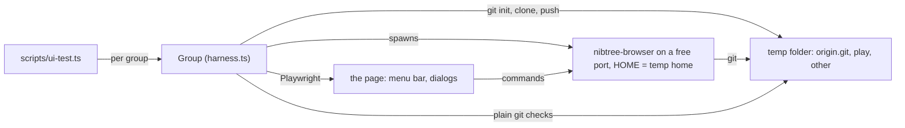

# Git Menu UI Tests

`scripts/ui-test.ts` clicks every item of the Git menu and its dialogs in the real page, and checks each result with plain git. It runs on every pull request in `browser.yml` (Linux x64) and on your machine.

## Why we need it

The Rust tests (`mcp/tests/git_tools/`) prove each git action works, but not that the buttons reach it. The first runs of these tests found nine dialogs whose button never ran git, a menu item that lost the caret, a menu that stayed open, a dialog that ignored Esc and three browser version gaps. None of them showed in any other test.

## How it works



- **The browser version is the app.** It is the same page, menu and dialogs as the desktop app, on the same Rust commands, so a test of the page tests both. Playwright only sends events to the page, never to the operating system.
- **Groups are independent.** `sync`, `branches`, `conflicts`, `changes`, `current-file`, `history` and `repos` each get new repositories (`play`, one commit behind `origin.git`, which `other` pushed to), their own home folder with its own git config, and their own server. Run one with `bun scripts/ui-test.ts conflicts`.
- **Checks wait for git, not for time.** `expect(name, condition)` polls a git condition for up to 15 seconds; `until` waits without recording. A failed check records the toasts and the notification center, and saves a screenshot in `ui-test-failures/`, which CI keeps as an artifact.
- **A page error fails the run.** `pageerror` is a failed check, which is how a dialog that throws gets caught.
- **Chromium by default.** It lets the test grant clipboard access, so Apply Patch from Clipboard is checked; `--browser webkit` (the engine of the macOS app) skips that one check.

## Running it

```sh
bun run build                          # the page
cd src-tauri && cargo build -p nibtree-browser && cd ..
bunx playwright install chromium       # once
bun scripts/ui-test.ts                 # every group, about two minutes
UI_TEST_TRACE=/tmp/trace bun scripts/ui-test.ts changes   # a screenshot after every step
```

## Where the code lives

| File | What it holds |
| --- | --- |
| `scripts/ui-test.ts` | Options, the group list, the run and the summary |
| `scripts/ui-test/workspace.ts` | `Workspace`: the repositories, the home folder, the server and plain git |
| `scripts/ui-test/harness.ts` | `Group`: the page, `menu`, `press`, `expect`, `until` |
| `scripts/ui-test/sync.ts` | Commit, Fetch, Pull, Push, Force Push, Update Project, remotes |
| `scripts/ui-test/branches.ts` | Branches, tags, Merge, Rebase, Interactive Rebase, Cherry-Pick, Reset, Undo |
| `scripts/ui-test/conflicts.ts` | Resolve Conflicts, the merge tool, Continue, Abort, Skip Commit |
| `scripts/ui-test/changes.ts` | Stash, Unstash, Shelve, Rollback and the selected-lines items |
| `scripts/ui-test/files.ts` | Current File, Log, Reflog, Bisect and Patch |
| `scripts/ui-test/repos.ts` | Worktrees, Submodules and Clone |

## Design decisions

- **The tests' own git runs with `GIT_OPTIONAL_LOCKS=0`.** Polling `git status` takes the index lock now and then, and the app's next write then failed with "could not write index". The app never polls git that way, so the lock belongs to the test.
- **Not covered:** LFS (`git-lfs` may be missing), the GitHub items (they need an account) and Open Repository in Browser (it needs a web remote).

## Bugs we fixed

The bugs these tests found are listed on their feature's page: [Git Menu Bugs We Fixed](Git-Menu-Bugs-We-Fixed.md) (nine dialogs), [the commit box](How-the-Commit-Box-Layout-Works.md) (the caret) and [the menus](How-the-Menus-Work.md) (a menu left open) and [conflict resolution](Conflict-Resolution-Bugs-We-Fixed.md) (Esc). Two were browser version gaps:

**Apply Patch from Clipboard read the server's clipboard.**
- **The issue:** in the browser version it read the clipboard of the machine running the server (`pbpaste` there), or failed in Docker, instead of what the person copied.
- **Why it happened:** the page asked the backend (`read_clipboard_text`), which is right only for the desktop app.
- **The fix and why we chose it:** the page answers `read_clipboard_text` itself (`browser/localCommands.ts`, `pageClipboard.ts`) with the browser's clipboard. A browser that will not give it, such as over plain http to another machine, says so instead of reading another machine's clipboard.

**A folder typed in the picker was ignored on Save.**
- **The issue:** typing a folder in the browser version's save or open picker and clicking Save without Enter saved into the folder still listed.
- **Why it happened:** Save used the listed folder, not the typed one.
- **The fix and why we chose it:** `choose` in `PathPicker.svelte` opens a typed folder first and only then saves there, or shows why it could not open it.

## Keeping this page in sync

- A new Git menu item or dialog gets a check in the group it belongs to, and a line in the table above when it adds a file.
- Keep each file under 300 lines: split a group before it grows past that.
