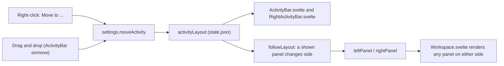

# How Activity Bar Positions Work

The user side is in [Activity Bars](../usage/Activity-Bars.md).

## Why we need it

People lay out their tools differently: some want Changes next to the Files tree, some want the file tree on the left like most editors. Every icon of the two activity bars can be moved to either bar, at the top or the bottom, and the panel it opens goes with it.

## How it works

- **The layout** (`ActivityLayout` in `ui/web/src/lib/logic/activityLayout.ts`) has four slots, `left-top`, `left-bottom`, `right-top` and `right-bottom`, each an ordered list of icon ids. `moveActivity` takes an id out of its slot and puts it at a place in another one; `normalizeActivityLayout` turns whatever `state.json` holds into a valid layout (unknown and repeated ids dropped, new icons added at their default place); `activityBarItems` gives one bar's `items`, top group, `null`, bottom group.
- **The library ActivityBar** draws each group in its own `data-activity-slot` box, so a drop anywhere on a bar lands in one. With `movable`, a press that travels 4 pixels becomes a drag: the shared `activityDrag` state (`logic/activityDrag.svelte.ts`) holds the icon and the target under the pointer, found with `elementFromPoint` and `dropIndex`, so either bar can draw the drop line. Release calls `onmove`, Esc cancels, and the click that ends a drag does not open the panel. A right-click calls `oncontextmenu`.
- **The app** keeps the layout in `settings.activityLayout`. `views/activityItems.svelte.ts` builds every icon (badges, tooltips), runs a click and builds the menu (Move to each other slot, Reset Positions); both bars are the same few lines.
- **Panels follow their icon.** `stores/sidePanels.ts` holds the six side panels and the two places that show them (`PanelSlots`: the left panel, the right panel and whether the right side is open). `showPanel` puts a panel on its icon's side, `togglePanel` is a click, and `followLayout` runs after every move: a shown panel whose icon changed side goes along. `parseState` runs it too, so a hand-edited `state.json` cannot show a panel on the wrong side. `Workspace.svelte` renders any panel in either side with one `sidePanel` snippet.

## Where the code lives

| File | What it does |
| --- | --- |
| `ui/web/src/lib/logic/activityLayout.ts` | Slots, moving, checking a saved layout, a bar's items, drop position (tested) |
| `ui/web/src/lib/logic/activityDrag.svelte.ts` | The drag shared by both bars, and the target under the pointer |
| `ui/web/src/lib/components/ActivityBar.svelte` | `movable`, `onmove`, `oncontextmenu`, the drop line |
| `src/lib/stores/sidePanels.ts` | Which side shows which panel (tested) |
| `src/lib/stores/settings.svelte.ts` | `showPanel`, `hidePanel`, `togglePanel`, `moveActivity`, `resetActivityLayout` |
| `src/lib/views/activityItems.svelte.ts` | Every icon, its click and its menu |
| `src/lib/views/Workspace.svelte` | Either side renders any panel |

## Design decisions

- **Pointer events, not HTML drag and drop.** Tauri takes over the web view's drag events for files dropped from Finder, and the tab strip and the Files tree drag with pointer events too.
- **One shared drag state** lets the drag cross from one bar to the other without the two components knowing each other.
- **The slots stay "left" and "right"** (`leftPanel`, `rightPanel`, `explorerOpen` in `state.json`), with any panel allowed in either. Old state files keep working, and every caller that said `setLeftPanel("changes")` now shows Changes wherever its icon is.
- **The layout is shared by all windows** (it is not a per-window key), like a preference; the open panels stay per window.
- **The divider** between Branches and the Log is gone: with icons that move, a fixed line would end up between the wrong ones.

## Tests

- `activityLayout.test.ts`: moving between and inside slots, the gap a moved icon leaves, checking saved layouts, a bar's items, the drop position.
- `sidePanels.test.ts`: which side a panel opens on, toggling, a shown panel following its icon, Reset Positions swapping two panels back.
- The `features` UI test (`scripts/ui-test/features.ts`) moves Changes with its menu and checks its panel moved and the place was saved, drags Files into the left bar's bottom group and opens it there, then resets.

## Bugs we fixed

None yet.

## Keeping in sync

- A new icon: add its id to `DEFAULT_ACTIVITY_LAYOUT` and a case to `activityItem`; a new side panel also goes in `SIDE_PANELS` and the `sidePanel` snippet.
- Retake `activity-bar-menu.png` when the bars or the menu change. See [Docs and Screenshots](Docs-and-Screenshots.md).
