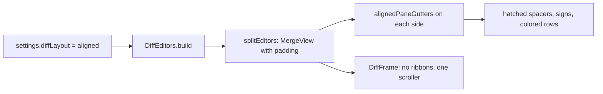

# How the aligned diff works

The **Aligned** layout is side by side the way VS Code draws it: both sides scroll in one container, every line is level with its match, and a hatched filler takes the place of lines a side lacks. This page explains how. The connected side by side layout is in [How the connected diff works](How-the-Connected-Diff-Works.md), the rest of the diff in [How diffs work](How-Diffs-Work.md), and the user side in [Aligned Diffs](../usage/Aligned-Diffs.md).

## Why we need it

The connected layout keeps each side as plain code and joins changes with bands. Many people come from VS Code and read diffs row by row: the old line and the new line on the same height, with one scrollbar. That is easier when a change is a long block, or when you compare two columns of similar code. The user asked for it as a fourth layout, next to the three that exist, with **Side by side** kept as the default.

## How it works

`@codemirror/merge`'s `MergeView` already does the alignment: its `measure` adds a spacer block widget (`.cm-mergeSpacer`) to the shorter side of every change and both editors grow inside the scrolling `.cm-mergeView`. The connected layout turns that off (`unpadded`); the aligned layout simply leaves it on.

1. **The setting.** `DiffLayout` in `settingsData.ts` is `"sideBySide" | "aligned" | "inline"`. Settings > Git lists it in `DIFF_LAYOUT_CHOICES`, and the toolbar (`DiffToolbar.svelte`) has an **Aligned** `ToggleButton` with the `split-aligned` icon. `DiffView.svelte` passes the setting to the toolbar and builds again when it changes; the layout is part of the scroll key.
2. **The editors.** `splitEditors` in `diffViews.ts` builds the same `MergeView` for both side by side layouts, with the same hunks, folds, blame and change buttons. Aligned, it uses `alignedPaneGutters` instead of `splitPaneGutters` and does not call `unpadded`. `DiffEditors` creates no `SplitLink`, so `ribbons` stays null and `DiffFrame` draws no connector.
3. **The frame.** Without ribbons, `DiffFrame` lets `.cm-mergeView` fill the body and scroll; with `ruler` it stops short of the change strip (the same rule as the connected layout), and the split handle leaves the ruler out of its width.
4. **The scroller.** `DiffEditors.#scroller()` is `view.dom` when aligned, else the new side's `scrollDOM`. Scroll restore on rebuild and **Open File**'s line (`newLineOnScreen`, which now measures from the scroller's top) use it. CodeMirror's `scrollIntoView` scrolls the outer container by itself, so jumps, F7 and the ruler's ticks need no change: the new side's heights include the spacers.

## The library part

`ui/web/src/lib/editor/alignedGutters.ts` holds everything that draws:

- `alignedPaneGutters(side, actions)`: each change's red or green through the gutter (`splitGutterColors`), the numbers on the left of both sides, the change buttons (`chunkActionGutter`) and a sign column.
- The sign column: a `StateField` of markers, a minus (U+2212) on the old side and a plus on the new, for every line `signLines` returns. It is rebuilt when CodeMirror's chunks change, as the colors are.
- `alignedDiffTheme`: the hatch is a `repeating-linear-gradient` in `--border-strong`, its stripe and period from the `diffFrame.fillerStripe` and `diffFrame.fillerGap` tokens; the sign column's width is `diffFrame.signWidth`. The gap lines that mark an empty side in the connected layout are turned off, since the filler already shows it.

The library's `DiffView` takes `layout="aligned"` too, with the same gutters, so the showcase story shows it.

## Where the code lives

| File | What it does |
| --- | --- |
| `ui/web/src/lib/editor/alignedGutters.ts` | Gutters, signs and the hatched filler |
| `ui/web/src/lib/components/DiffView.svelte` | The `aligned` layout of the library view |
| `ui/web/src/lib/components/DiffFrame.svelte` | One scroller, the ruler offset |
| `ui/design-tokens/components.json` (`diffFrame`) | `fillerStripe`, `fillerGap`, `signWidth` |
| `src/lib/stores/settingsData.ts` | `DiffLayout`, `DIFF_LAYOUT_CHOICES` |
| `src/lib/diff/diffViews.ts` (`splitEditors`) | Padding on or off, which gutters |
| `src/lib/diff/diffEditors.svelte.ts` | No `SplitLink` when aligned, `#scroller()` |
| `src/lib/diff/splitChunks.ts` (`copyViewChange`) | The stage and unstage edit, for both layouts |
| `src/lib/diff/DiffToolbar.svelte` | The **Aligned** button |

## Design decisions

- **A fourth layout, not a switch.** The connected view stays as it is and stays the default; aligned is one more value of `diffLayout`, so Settings, the toolbar and the scroll key handle it like the others. The three-column view is still only offered from side by side (`showsThreeColumns`).
- **Reuse MergeView's padding.** The spacers are MergeView's own, measured from real line heights, so wrapped lines, folds and blame widgets stay aligned without our code.
- **Copy without the link.** Staging a change from its button used to go through `SplitLink.copy`. It is now `copyViewChange` in `splitChunks.ts`, so the aligned layout, which has no link, stages the same way.
- **Signs next to the text.** Like VS Code and like our inline layout, a sign makes a change readable without color, and the numbers stay on the left where they are in a normal editor.

## Tests

- `ui/web/src/lib/editor/alignedGutters.test.ts`: which lines get a sign on each side, and none where a side has no lines of a change.
- `src/lib/stores/settingsData.test.ts`: `"aligned"` is kept, and unknown `diffLayout` values still fall back to side by side.
- The look and the scrolling need a visual check: `diff-aligned` in `scripts/screenshots.ts`.

## Keeping this page in sync

- A new diff gutter must go into `alignedPaneGutters` as well as `splitPaneGutters`.
- After updating `@codemirror/merge`, check that spacers still use the `.cm-mergeSpacer` class.
