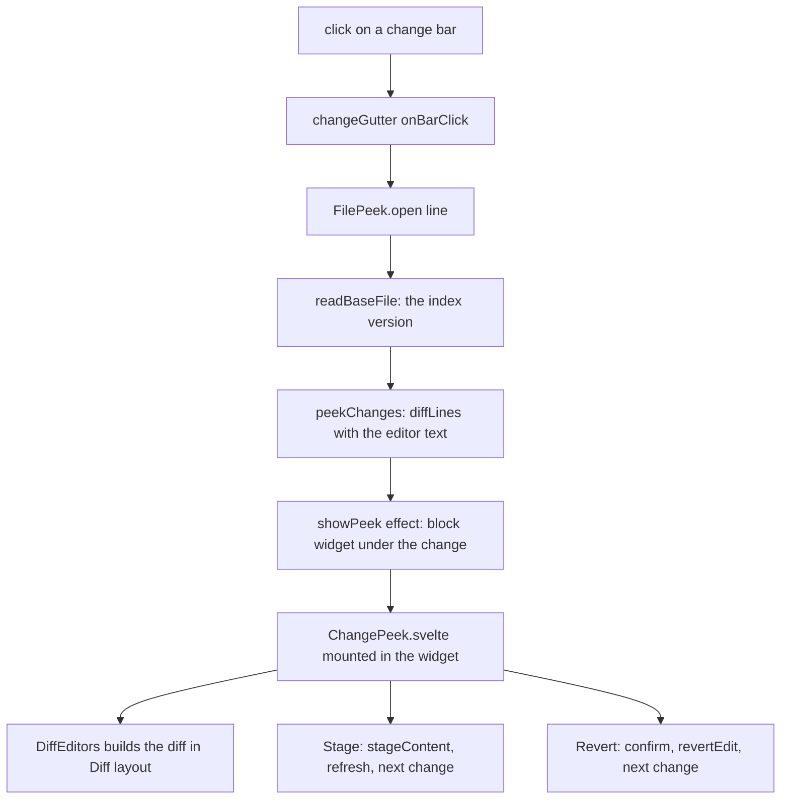

# How the change peek works

A click on a change bar in the file editor opens a panel under the change with its diff against the index, and buttons to stage it, revert it and move between changes, like VS Code's quick diff peek. This page explains how. The user side is in [Change Peek](../usage/Change-Peek.md); the editor and its bars are in [How the Editor Works](How-the-Editor-Works.md).

## Why we need it

The bars only said that lines changed. To see what changed you had to open the Changes diff, and a click on a bar reverted the change straight away (after a confirm). Users coming from VS Code expect the click to show the change in place, with Stage and Revert next to it.

## How it works

### The base: the index

The bars and the peek compare with the index, like VS Code. `git/base_file.rs` reads the file's stage 0 entry from the index. A file with no such entry (being merged with conflicts, or removed from the index) falls back to HEAD, and an untracked file reads as empty, so all its lines are added. `line_change_marks` measures the marks against it and returns its version as `base`. `base_file_version` gives the HEAD commit (blame follows it) and the index entry's object (the marks follow it), so staging the file makes the next refresh update the bars. `read_base_file` returns the text.

### The widget

`changePeek/peekField.ts` holds one optional `PeekTarget` (a token and the position at the end of the line the peek sits under) in a `StateField`, set by the `showPeek` effect. Block widgets must come from a field, not a plugin. The widget's `ignoreEvent` returns true, so the editor leaves the clicks and keys inside it to the diff editor nested there; CodeMirror skips DOM it does not own when it reads mutations. Any edit of the text closes the peek, since its diff would be stale.

### The controller

`changePeek/filePeek.ts` (`FilePeek`, owned by `FileGitInfo`) reads the base, diffs it with the editor's text (`peekChanges`, the frontend's `diffLines`) and finds the change on the clicked line with `changeAtLine`. `peekLine` puts the peek under a change's last line, or above a deletion. `#show` moves the cursor to the change and dispatches `showPeek` with a new token; the widget's `toDOM` mounts `ChangePeek.svelte` with Svelte's `mount`, and `destroy` unmounts it, also when the widget scrolls out of the viewport.

- **Stage** writes `stagedText` (the index text with this one change's lines in it) with `stage_content`, through `repoStore.run` with a status refresh. It then refreshes the bars and opens the peek again on the same index, now the next change.
- **Revert** confirms, checks the text is still the one it diffed, and dispatches `revertEdit` with `userEvent: "input.revert"`, then opens the next change. See [How reverting a change works](How-Reverting-a-Change-Works.md).
- **A change's own Revert** in the diff: `ChangePeek` passes `onRevert` (inline) and a `bands` revert on the right side (side by side and aligned) to `DiffEditors`. Each hands over the change's lines, which `hunkIndexOf` maps back to the peek's change; `FilePeek.revert(target)` reverts that one, and `indexAfterRevert` keeps the peek on the change it showed.
- **Next** and **Previous** wrap with `stepIndex`.

### The panel

`ChangePeek.svelte` draws the UI library's `PeekPanel` (a header with a title, a detail and buttons, the content at a set `viewHeight`, and lines in the change's tone). Inside it, a `DiffFrame` and the diff view's own `DiffEditors` build the diff in `settings.diffLayout`, read-only, with the peek's hunks (`viewHunks`) so the diff shows exactly the changes the counter counts. `revealLine` scrolls it to the change on every build, also after a layout switch.

## Where the code lives

| File | What it does |
| --- | --- |
| `src-tauri/src/git/base_file.rs` | The index version, with the HEAD fallback |
| `src-tauri/src/commands/editor.rs` | `line_change_marks`, `base_file_version`, `read_base_file` |
| `src/lib/views/files/changePeek/peekModel.ts` | Changes, kinds, the peek's line, counter, steps, staged text |
| `src/lib/views/files/changePeek/peekField.ts` | The field, effect and block widget |
| `src/lib/views/files/changePeek/filePeek.ts` | Open, step, stage, revert, mount |
| `src/lib/views/files/changePeek/ChangePeek.svelte` | The panel and its diff |
| `src/lib/views/files/fileGitInfo.ts` | Owns the peek; marks against the base |
| `ui/web/src/lib/components/PeekPanel.svelte` | The library panel (tokens `peekPanel.*`) |

## Design decisions

- **Compare with the index.** The user chose VS Code's behavior: the bars show what is not staged yet, so Stage in the peek makes sense and a staged change drops out. Conflicted files fall back to HEAD, since the index has no single version of them then.
- **Follow Diff layout.** The peek is the same diff as everywhere else (`DiffEditors`), so all three layouts, folds and the ruler work in it with no second diff view.
- **Diff in the frontend.** The peek diffs the index text with the editor text itself, so the counter, the shown change and Stage and Revert agree with each other even while the bars are being recomputed.
- **Close on edit.** Keeping the peek open while typing would need its diff rebuilt on every key; VS Code closes it too.
- **Stage the editor's text.** Like VS Code, Stage takes the lines as they are in the editor, saved or not.

## Tests

- `src/lib/views/files/changePeek/peekModel.test.ts`: kinds, the change on a line and a deletion's line, where the peek opens, staging one change of several, a new file and a last line without a break, the counter and wrapping, and mapping a change's own Revert button back to its change.
- `src-tauri/src/commands/editor.rs`: marks against the index, a staged line leaving the marks and changing the version, a conflicted file comparing with HEAD, a staged rename.
- The widget, the buttons and scrolling need a check in the app: `change-peek` in `scripts/screenshots.ts`.

## Keeping this page in sync

- A new action in the peek goes into `ChangePeek.svelte`'s header and `FilePeek`.
- If the bars ever compare with something else, change `base_file.rs` and `readBaseFile` together, so the bars and the peek agree.
