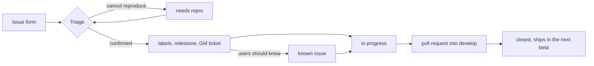

# Project Tracking

How work is tracked on GitHub: the issue forms, the labels, the milestones, known issues, private security reports and the files every open source repository is expected to have. [Contributing](Contributing.md) has the rules for code, commits and pull requests.

## Why we need it

A feature list in a plan file helps the person who wrote it. Issues, labels and milestones help everyone else: a user can see whether a bug is known and has a workaround, a contributor can find work that fits, and the maintainer can see what blocks the next release.

## The life of an issue

## Issue forms

The forms live in `.github/ISSUE_TEMPLATE/`:

- **`bug_report.yml`** (labeled `bug`, titled `[Bug]: ...`) asks what happened, the steps to reproduce, the Nibtree version, the operating system, the `git --version` output and any screenshots. Report a Bug in the app (Settings, About, the status bar help menu or the welcome screen) opens this form with the version and operating system already filled in, using the field ids `version` and `platform` (see `bugReportUrl` in `src/lib/update/releases.ts`). Keep those ids if you edit the form, or the pre-filling stops working.
- **`feature_request.yml`** (labeled `enhancement`, titled `[Feature]: ...`) asks what the person wants to do, how it should work and what they tried instead. The app links to it from the same places.
- **`documentation.yml`** (labeled `documentation` and `area: docs`, titled `[Docs]: ...`) asks for the page and what is wrong or missing.
- **`config.yml`** keeps blank issues allowed and links the known issues, the user guide, the private security report and the releases page, so people find an answer before they write.

## Labels

Every issue gets one kind, at least one area and, while open, a priority.

| Group | Labels | Meaning |
| --- | --- | --- |
| Kind | `bug`, `enhancement`, `documentation`, `question` | What the issue is |
| Kind | `known issue` | A problem or limitation in a released version that users should know about, with a workaround when there is one |
| Kind | `tracking` | A pinned issue that lists others, such as the roadmap and the known issues |
| Area | `area: git`, `area: diff and merge`, `area: editor`, `area: markdown`, `area: files`, `area: terminal`, `area: ai`, `area: ui`, `area: ui library`, `area: native`, `area: mcp and cli`, `area: performance`, `area: windows`, `area: linux`, `area: browser`, `area: ci and release`, `area: testing`, `area: docs` | The part of the project |
| Priority | `priority: high`, `priority: medium`, `priority: low` | The order to work in |
| State | `in progress`, `needs repro` | Someone is on it; seen once and needs steps |
| Help | `good first issue`, `help wanted` | Good places for a new contributor |

## Milestones

A milestone is either a release or a theme:

- **`0.1.0 betas`** (closed) holds every shipped feature as a closed issue that links its user page and developer chapter, so the issue list doubles as a feature index.
- **`0.1.0`** is the first stable release: the real-app test pass, the docs and screenshots still owed, and open questions.
- **`0.2.0`** collects follow-ups to shipped features, in-app updates, signed builds and platform gaps.
- **Themes**: Markdown like JetBrains, Performance and memory, Browser version parity, UI library and Swift twin, and Nibtree Native. Each holds a larger plan split into issues.

When a theme item is picked for a release, move it to that release's milestone. The maintainer also keeps a private GitHub Project board over the same issues, with a Status and a Priority field.

## Known issues

Label a problem `known issue` when it is in a released version and users may run into it, and write the workaround in the issue. The issue forms link straight to the open known issues, and so do the README and `SUPPORT.md`. Close the issue when the fix ships in a beta, and add the fix to the feature's "Bugs we fixed" section as usual.

## Security reports

Security problems never go in a public issue. `SECURITY.md` says which versions get fixes, what matters most (the browser version's server and token, the MCP server, untrusted repositories, secrets) and asks for a private report through GitHub's **Report a vulnerability**. Turn on **Private vulnerability reporting** under Settings, Code security, or that link leads nowhere. Fix the problem in a private fork from the advisory, release it in a beta, then publish the advisory.

## Community files

GitHub's community profile looks for these at the repository root or in `.github/`:

| File | What it holds |
| --- | --- |
| `README.md` | What Nibtree is, downloads, badges, the roadmap and known issues links |
| `LICENSE` | MIT |
| `CONTRIBUTING.md` | The short version of [Contributing](Contributing.md), linking here |
| `CODE_OF_CONDUCT.md` | Contributor Covenant 2.1 |
| `SECURITY.md` | The security policy above |
| `SUPPORT.md` | Where to ask for help |
| `.github/CODEOWNERS` | The maintainer reviews every pull request |
| `.github/pull_request_template.md` | What and why, the test plan and the docs checklist |

## Dependency updates

`.github/dependabot.yml` opens one grouped pull request a month against `develop` for GitHub Actions, for minor and patch updates of the Rust crates in `src-tauri` and for the Bun packages. Major updates come one by one, since they can break the build. Its commits start with `chore`; give the pull request a `GM` ticket in its title before merging, like any other change, and let CI (with `--frozen-lockfile` and `--locked`) prove the new lockfiles. **Dependabot security updates** (Settings, Code security) open a pull request as soon as an advisory affects a dependency.

## Keeping in sync

- A new feature that ships gets a closed issue in `0.1.0 betas` (or the current release milestone) linking its pages.
- A new area of the code gets an `area: ...` label, added to the table above.
- Renaming a milestone means updating this page and `CONTRIBUTING.md`.
