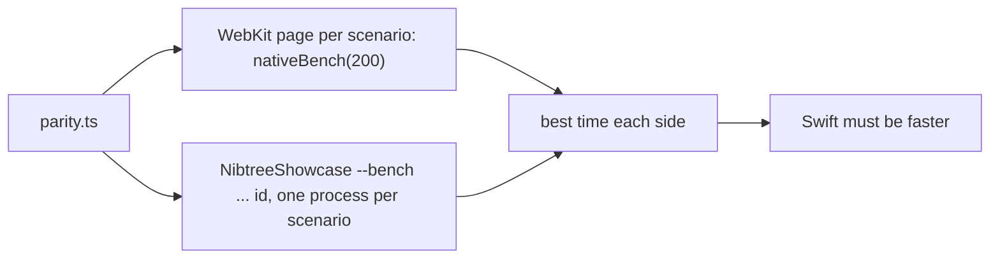

# Swift UI bench

The parity gate times every scenario on both sides and fails a Swift component that is not faster than its web twin
(see [Swift UI parity](Swift-UI-Parity.md)). This page explains how it times both sides fairly and what the Swift
harness costs. What the components themselves do to stay fast is in [Swift UI speed](Swift-UI-Speed.md).

## How the gate times a scenario

Each side builds and lays out 200 copies of the scenario, draws the ones in a 1000 by 800 point window, a few times
after warming up, and keeps its best time.
The web side does it in a fresh WebKit page per scenario. The Swift side runs `NibtreeShowcase --bench` once per
scenario, in its own process, for the same reason (see the bugs below). Both sides are timed back to back, and a
scenario Swift loses is timed twice more, both sides, before it fails.

## The harness's own cost

The harness turns a scenario's JSON into views (`ScenarioView` and one file per library group in
`Sources/NibtreeShowcase/Parity/Groups`), and every child pays for that too:

- **One `AnyView` per node.** SwiftUI makes one nested view type of all a `switch`'s cases, and every node pays for
  each level. The harness's switches (node kind, library group, child count) cost a row of two checkboxes a third
  of its time, where the same row written as code pays none. `@Erased`, a result builder, makes every case one
  `AnyView`, which costs a tenth of that, so adding a component never makes the others slower.
- **Children written out.** A `ForEach` gives every child its own subgraph. `ScenarioChildren` writes up to eight
  children out like a static stack's (a row of eight Spacers drew in 100 ms through `ForEach`, 85 ms written out).

Code in the app is static, like the written-out children, so the gate's Swift times are on the slow side.

## Bugs we fixed

**Stacks, splits and frames failed the speed check.** Twenty-eight scenarios (stacks with several children, splits,
merge frames, text lists) were slower than the web, and only in the full run: alone they passed.

Why: the bench ran every scenario in one process. `icon-every-name` draws every icon 200 times (almost 2 seconds and
about 440 MB), and every scenario after it ran about 1.7 times slower. Draining the autorelease pool per run did not
help: the process stays slower once it has grown.

Fix: `parity.ts` runs the bench once per scenario (`--bench <folder> <count> <warmup> <runs> <id>`), the way the web
side loads a fresh page per scenario, so one heavy scenario cannot hide or cause a failure in another.

**CI failed the speed check while a Mac passed.** On GitHub's runner a third of the scenarios were slower than the
web, and different ones in each run, while every one passed on a Mac.

Why: the gate timed every Swift scenario first and every web one minutes later. A fresh runner indexes the checkout
and the build (Spotlight) in its first minutes, so Swift was timed on a busy machine: the first scenarios twice as
slow as on a Mac, the web side as fast. A loaded Mac flattered Swift the same way the other way round.

Fix: each scenario is timed Swift then web, back to back, so both see the same machine; a loser is timed twice more
before it fails; and the CI speed job turns Spotlight off. CI runs match and speed as two jobs side by side, so the
speed job is not also taking pictures.

**Swift drew copies no one could see.** Why: the bench clips its list to the window, but SwiftUI still records every
copy's drawing; WebKit paints only what is on screen. Fix: copies below the window are `.hidden()` (laid out, not
drawn). `text-sizes` went from 266 to 128 ms.

**Small scenarios still failed on CI by a few milliseconds.** After the fixes above, 13 of 152 lost on GitHub's
runner, each by less than 10 ms. GitHub's web side ran faster than a Mac's, the Swift side about the same.

Why: the harness, not the components. A row of two checkboxes took 35 ms through the harness and 25 ms written as
code; the nested types of the harness's switches were the difference.

Fix: `@Erased` (above), and the copies' height and hiding chosen once for all copies instead of in each one. Every
scenario got 15 to 25% faster, in the gate and nowhere else, since the app's code is static.

## Where the code lives

| File | What it does |
| --- | --- |
| `ui/swift/scripts/parity.ts` | Times both sides back to back, one Swift process per scenario |
| `ui/swift/Sources/NibtreeShowcase/Parity/ParityRunner.swift` | `--bench`: copies, warm-ups, best run |
| `ui/swift/Sources/NibtreeShowcase/Parity/ScenarioView.swift` | `@Erased` and `ScenarioChildren` |
| `ui/web/src/native/` | The web side's timing list (`nativeBench`) |

## Keeping this page in sync

Update it when the timing rules change, or when a finding changes how the harness is built.
