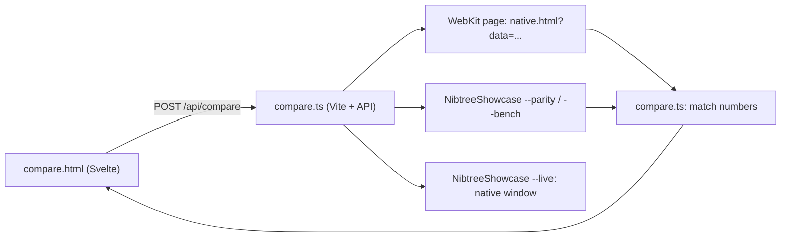

# Swift UI Compare

The compare tool shows a component from the web UI library and its Swift twin side by side, with the same props, and the Swift one live in a native window. You change a prop and see both draw it again in light and dark, with how much they match and, when you ask, which one draws faster. It uses the same code and numbers as the parity gate in [Swift UI Parity](Swift-UI-Parity.md), so what passes here passes there.

## Why we need it

The parity gate runs every scenario and prints a line per scenario. That is right for CI but slow for building a component: you want to try one prop value, see the difference, fix it and try again. The tool also finds cases nobody wrote yet. Its first find was a vertical `Divider` alone in a frame: the web centered it and Swift put it at the left edge, because the Swift frame did not lay out its content like the web frame's flex column.

## How to use it

Run `bun run ui:swift:compare` and open `http://localhost:1433/compare.html`. The first start builds the Swift showcase in release, which takes about a minute.

- **Component and scenario.** Pick a component that has a Swift twin, then one of the scenarios that use it, or **New scenario** to start from the component alone.
- **Nodes.** A scenario is a tree, such as a Stack with Icons in it. Click a node to edit its props.
- **Props.** Every prop the web docs list gets a control: a choice, a switch, a number or a text. **default** removes the prop, so each side uses its own default. A **web only** mark means the Swift twin does not draw that prop yet.
- **State.** Components that draw interaction states get a **state** choice: see [Swift UI States](Swift-UI-States.md).
- **All values.** Draws the selected node once per value of each prop and once per state, as a grid with each cell's match ([Swift UI States](Swift-UI-States.md)).
- **Results.** For each theme you see web, Swift and the differences (pixels off by more than the tolerance, in magenta), with the match within one device pixel and at the same spot. Both must be 99%.
- **Measure.** Draws the chosen number of copies on each side, a few times after warming up, and shows the best time of each.
- **Rebuild Swift.** Builds the showcase again after you change Swift code; the page then compares again.
- **Scenario JSON.** For bigger changes, such as adding a child or a slot. **Save as scenario** adds the case to `ui/swift/parity/<Component>.json`, so the gate checks it from then on. Ids must be unique.
- **Live web component.** The web side drawn by your own browser, to try hover and dragging.
- **Native window.** The Swift side live: a window of the Swift showcase draws the same scenario with the real components, in light and dark, and redraws it as soon as you change anything, so you can point at it next to the live web one. It opens with the first scenario. If you close it, it stays closed until you press **Native window**, which also brings it to the front. **Rebuild Swift** restarts it on the new build. Sizes such as a split's come from the scenario on both sides, so a handle shows when pointed at but the panes do not move.

## How it works

The page sends the scenario as JSON. The server opens `native.html?data=<scenario>` in WebKit (the browser the gate uses) and screenshots it, writes the scenario to a scratch folder for the Swift showcase, and compares the two pictures with the gate's `compare.ts`. Requests run one at a time, because they share one WebKit page and the scratch folder. The page waits until you stop typing, and drops an answer to an older version of the scenario.

The native window is the showcase started with `--live <file>`. On every change the server writes the scenario to that file (beside it, then renamed in, so the window never reads half a file). The window watches the file's folder with a dispatch source, so it redraws at once and never polls. A `focus` number in the file goes up when you press **Native window**, which brings the window to the front without taking the focus on every edit.

## Where the code lives

| File | What it does |
| --- | --- |
| `ui/swift/scripts/compare.ts` | The server: Vite on port 1433 plus the API routes |
| `ui/swift/scripts/parity/compareSession.ts` | Compare, measure, rebuild and save, one at a time |
| `ui/swift/scripts/parity/png.ts`, `browser.ts`, `swiftBinary.ts` | Shared with the gate: PNG pixels, the diff picture, the Swift build |
| `ui/swift/Sources/NibtreeShowcase/Parity/LiveWindow.swift` | The native window (`--live <file>`) |
| `ui/web/compare.html`, `ui/web/src/native/compare/` | The page, built from the library's own components |
| `ui/web/src/native/compare/propControls.ts` | A prop's doc type as a control (`IconName`, `IconSize` and `TextStyleName` list their values) |
| `ui/web/src/native/compare/scenarioEdit.ts` | Finding and changing a node in a scenario |

## Tests

- `compareLogic.test.ts`: unions, named types, flags, numbers and objects become the right controls, snippets and callbacks get none; nodes are found in children and slots; a prop is set or removed without changing the original; new scenarios get unique ids.
- `props.test.ts`: `harnessProps` reads which props the Swift harness draws, per component.
- `png.test.ts`: the PNG decoder undoes every row filter (the pixels used to come from the WebKit page as a JSON array, seconds per picture).

## Keeping this page in sync

When a doc type uses a new named type, add its values to `NAMED_TYPES` in `propControls.ts`. When the gate changes how it compares or times, the tool follows by itself, since both use the same modules.
