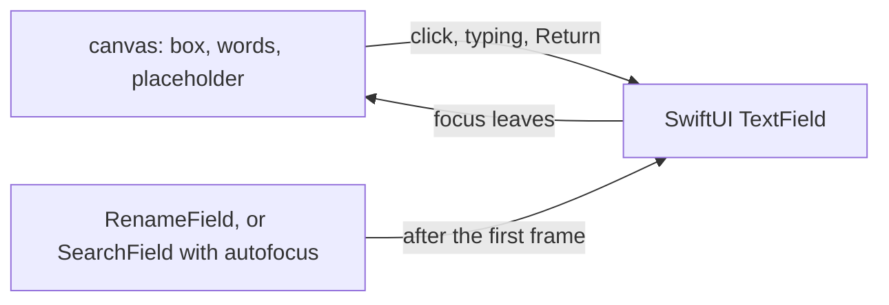

# Swift UI form controls

The web library's text fields, drop-downs, checkboxes and radios are WebKit's own controls with CSS on top. WebKit
sizes and paints parts of them itself, so their Swift twins copy those parts too. This page lists what each copies,
how it was measured, and why the Swift controls draw a picture until they are used. General WebKit rules (flex
shrinking, ellipses, baselines) are on [Swift UI and WebKit's rules](Swift-UI-WebKit.md).

## A picture until it is used

An AppKit text field in every input was the slowest thing in a form: a column of rename fields took four times the
web's time. So a Swift control draws itself in one canvas at rest and becomes a real control only when needed:

- `NInput` and `NSearchField` turn into a text field on a click, on Return or on typing (what was typed is kept).
- `NRenameField` starts editing when it appears, as the web's does: the canvas draws its first look (the whole name
  selected), and the text field takes over one main-queue turn later. A picture drawn at once (the parity gate's)
  keeps the canvas's look, since ImageRenderer draws an AppKit field as a yellow placeholder box.
- `NSelect` stays a picture: a click opens AppKit's pop-up menu at the control, the chosen item checked, as a native
  `<select>` does on macOS. Up and Down step through the choices without wrapping.

## The rules

**Text field width.** With no width set, a field is as wide as 20 of its font's zeros in WebKit's layout units
(1/64 point, rounded), plus 2 points for the caret, its padding and border. A text area is the same with the zeros
rounded up to a whole point and no caret. `NInputLook.fieldWidth` does this for Input, SearchField and RenameField.

**`width: 100%` in a column.** A field with `width: fill` fills its column even when the column keeps its other
children at their own width (`align-items: flex-start`). The Swift field marks itself `align-self: stretch` for it.

**`flex: 1` in a column.** RenameField grows into a row (`flex: 1`). In a column the same rule makes it 18 points
tall, since its height starts from nothing; the app only puts it in rows, so its scenarios are rows too.

**Selected text.** A focused field's selection is AppKit's selected text color, opaque in light mode and at 80% in
dark mode. Selected words keep their color in light mode and turn AppKit's selected text color (white) in dark mode.
The selection is as tall as the font's ascent and descent together, rounded, and centered in the line.
`NWebKitColors.selection` and `selectedText` hold these.

**Drop-down width.** A `<select>` is as wide as its widest choice (disabled ones too), rounded up to a point, plus
its padding, the arrow's room and its border, at most the large control width. A chosen label too long for it is
clipped at the padding, with no ellipsis.

**Placeholders, radios and the grip.** A placeholder is WebKit's `darkGray` in both themes. A radio is 12 points
round: a 1.5 point ring in AppKit's secondary label color, or the accent with a 3.5 point white dot. A text area with
`resize: vertical` shows a grip of two 1 point strokes at 45 degrees, 6 points in from the corner. A checkbox is a
12 point continuous-corner square (`NCheckboxBox`, which FileRow draws in its own canvas too).

**Focus rings.** `NSelect` lets AppKit draw its keyboard focus ring: watching the focus to draw the web's own ring
cost a column of drop-downs a third more time.

## Bugs we fixed

**A field that should fill its column kept its own width.** Input's `fill` scenario showed a short field where the
web's reached the column's edge, and still passed at 99.5% because the empty space matched. Why: CSS `width: 100%`
fills the column even when the column does not stretch its children, but the Swift column offered no width. Fix:
a filling field asks its column to stretch it, the same `align-self` the column already honors.

**Fields after an auto-width one sat a fraction of a pixel off.** Why: WebKit stores the 20 zeros' width in 1/64
point steps (164.246 becomes 164.25). Fix: `fieldWidth` rounds the same way.

## Where the code lives

| File | What it does |
| --- | --- |
| `ui/swift/Sources/NibtreeUI/Layout/NInputLook.swift` | Field sizes, the shared field width |
| `ui/swift/Sources/NibtreeUI/Components/NRenameField.swift` | The first look and the text field after it |
| `ui/swift/Sources/NibtreeUI/Layout/NSearchFieldLook.swift` | SearchField's sizes and canvas |
| `ui/swift/Sources/NibtreeUI/Layout/NSelectLook.swift`, `Logic/NSelectMenu.swift` | Drop-down width, the menu |
| `ui/swift/Sources/NibtreeUI/Theme/NWebKitColors.swift` | Control, selection and placeholder colors |
| `ui/swift/Sources/NibtreeUI/Layout/NTextAreaLook.swift` | Text area sizes and the grip |

## Tests

`InputTests`, `RenameFieldTests` and `SearchFieldTests` put real windows on screen (clear, far off the screens, in
the serialized `Windowed` suite, as two at once take the focus from each other) to check that a field becomes a text
field, starts with its name selected, and ends a rename once. `SelectTests` checks the menu and the widths.

## Keeping this page in sync

Add a rule here when a control copies something WebKit sizes or paints on its own, with how it was measured.
