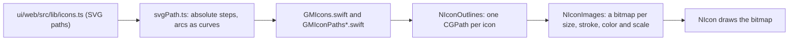

# Swift UI Icons

The Swift library draws the same icons as the web library, from the same source. This page explains how the icons get from `ui/web/src/lib/icons.ts` into Swift, why `NIcon` draws them into a bitmap, and the small layout pieces that came with them (`NDivider`, `NSpacer`). The library itself is in [Swift UI Library](Swift-UI-Library.md), and the check that keeps it like the web is in [Swift UI Parity](Swift-UI-Parity.md).

## Why we need it

Icons are in almost every component: rows, buttons, tabs, menus. If the native app had its own icon set, or drew the web's icons a little differently, every screen would drift. So there is one list of icons, written once as SVG paths, and every platform gets it from there.

## How it works

`bun run ui:tokens` reads the icons and turns every path into four simple steps: move, line, cubic curve and close. Relative steps become absolute, `H` and `V` become lines, `S` becomes a full curve, and arcs (an SVG path command for part of a circle or ellipse) become cubic curves of at most a quarter turn each. Doing this once, when the files are generated, means the app never parses SVG while it draws.

The output is two kinds of file in `ui/swift/Sources/NibtreeTokens`:

- `GMIcons.swift`: `GMIconName`, one case per icon with its web name as the raw value (`chevron-right` is `.chevronRight`), and `GMIconOp`, the four steps.
- `GMIconPaths.swift`, `GMIconPaths2.swift` and so on: each icon's steps on the 24-point grid, split so every file stays under 300 lines.

`NIcon` takes the same props as the web `Icon`: `name`, `size` (`NIconSize`, from the icon size tokens), `stroke` (`NIconStroke`) and `tone`. A `tone` of nil is the web's `inherit`: the icon takes `nibtreeCurrentColor` from the environment, like CSS `currentColor`. The text color is the default, and a component such as a disabled row can set it. The dotted `more` icon always uses the heavy stroke, as on the web.

## Bugs we fixed

**Circles and rounded corners were a tenth of a pixel small.** The first `NIcon` stroked its path in a SwiftUI `Canvas`. Straight lines matched the web exactly, but every circle, arc and rounded corner came out slightly smaller, so two scenarios missed the 99% bar (98.8%). Lowering Core Graphics' flatness changed nothing, and stroking with `GraphicsContext` gave the same numbers. SwiftUI's own renderer turns curves into short straight chords, and chords sit inside the curve. WebKit strokes with Core Graphics, which follows the curve more closely. The fix strokes each icon with Core Graphics into a bitmap and draws the bitmap. That matches the web at 100% at the same spot. On its own it was slower than the web, so `NIconImages` keeps each bitmap by icon, size, stroke, color and screen scale. Drawing a kept bitmap is faster than stroking the path again, so the icon scenarios now beat the web by 25 to 35%. The store holds at most 512 bitmaps (a 16-point icon is about 4 KB at 2x) and starts over when full.

## Divider and Spacer

`NDivider` stretches across a column and centers in a row whatever the stack's `align`, like CSS `align-self`. Stacks read `NStackAlignSelf`, a layout value any child can set. A vertical divider takes its length and side space from `nibtreeDividerMetrics`, the Swift side of `--divider-length` and `--divider-space`, so a toolbar can set them later. `hideAt` waits for the responsive Toolbar. `NSpacer` is an empty view marked `NStackGrows`, so it takes the free room like `flex: 1 1 0`.

## Where the code lives

| File | What it does |
| --- | --- |
| `ui/design-tokens/build/svgPath.ts` | SVG path to absolute steps, arcs to curves |
| `ui/design-tokens/build/icons.ts` | Writes `GMIcons.swift` and `GMIconPaths*.swift` |
| `ui/swift/Sources/NibtreeUI/Components/NIcon.swift` | The icon view |
| `ui/swift/Sources/NibtreeUI/Layout/NIconImages.swift` | Outlines and the bitmap store |
| `ui/swift/Sources/NibtreeUI/Presets/NIconPresets.swift` | `NIconSize`, `NIconStroke` |
| `ui/swift/parity/Icon.json`, `Icon.names.json` | Every name, size, stroke and tone |

## Tests

- `svgPath.test.ts`: relative steps, numbers written together (`1.5.5`), arc flags written together, `S`, half circles that stay on the circle, every library icon parses, and the generated files stay within the line limits.
- `IconTests.swift`: every outline stays on the 24-point grid, a circle reaches its radius on every side, and a bitmap is made once per key.
- The parity scenarios draw every icon, and the gate fails if one is missing in Swift.

## Keeping this page in sync

When you add an icon to `icons.ts`, run `bun run ui:tokens` and commit the Swift files with it (CI checks they are fresh). A path command other than M, L, H, V, C, S, A and Z stops the generator with an error: add it to `svgPath.ts` with a test. Update this page when `NIcon` draws differently.
