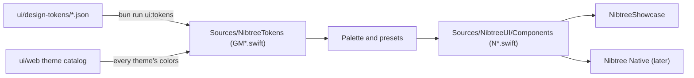

# Swift UI Library

`ui/swift` is the SwiftUI twin of the [UI Library](UI-Library.md): the same components, with the same names and the same props, drawn with SwiftUI instead of Svelte. The native macOS app, **Nibtree Native**, is built from these components only, the same way the Tauri app is built from `ui/web`.

## Why we need it

The native app has to look like the Tauri app, pixel for pixel, and stay that way as both change. Building screens straight in SwiftUI would copy every size and color by hand, and the two apps would drift apart. With one component per web component, both apps draw from the same design tokens, and a screen is composed from components that are checked one by one.

## How it works

The package has three targets:

- **NibtreeTokens** holds the generated `GM*.swift` files: colors, sizes, text styles, every component's measurements, and all 42 color themes with their colors already worked out. `bun run ui:tokens` writes them; nobody edits them by hand. `GMColorToken` lists every color name, so a component cannot ask for a color that does not exist.
- **NibtreeUI** holds the components. Each one is `N<Name>`, named after its `ui/web` twin (`NText` is `Text`, `NStack` is `Stack`). The `N` keeps them apart from SwiftUI's own `Text` and `Stack`-like views.
- **NibtreeShowcase** is the twin of `bun run ui`: a window with every story in light and dark side by side, and a picker for each appearance's color theme.

### Colors and themes

`Palette` is one color theme in one appearance. `.nibtreeTheme(light:dark:)` picks the light or dark theme from the view's appearance, like the app's two color theme settings, and components read it with `@Environment(\.nibtreePalette)`. Colors are given to SwiftUI as sRGB, like CSS colors, so they match the web view.

### Props become presets

A web prop with named values becomes a Swift enum with the same names: `gap: "md"` is `gap: .md`, and `NSpacing.md.points` is 8 because the space token says so. No component takes a free number for a size or a color, the same rule as `ui/web`. HTML-only props (`element`, `role`) are left out, the responsive `hideAt` and `dotAt` come with the responsive Stack and Toolbar, and each component's doc comment says which ones. A `corner` badge takes no room, so a button adds it with `.overlay(alignment: .topTrailing)`. A tooltip (`title` on the web) is SwiftUI's own `.help("...")` on the component, and StatusDot's `pulse` is `.nibtreePulse()`, so only views that have one pay for it. A Time hands its words to a text (`NTime(time: date) { NText($0, tone: .dim) }`), and a control's value and `onchange` are one binding. A browser control is drawn like WebKit's: a checkbox in system colors, a slider's accent adjusted for contrast.

`NStack` lays out its children with `NStackLayout`, a small SwiftUI `Layout` that does the flexbox subset `Stack` uses: a gap, cross-axis alignment with stretch, `justify: between`, `grow` (children marked with `NStackGrows` share the free length, like `flex: 1 1 0`), and the padding, so a stack is one SwiftUI view. A surface and a line are one canvas behind it. A `scroll` stack only becomes a scroll view when its content does not fit, like `overflow: auto`: a scroll view is an AppKit view and costs many times a stack. The catch is that its children are made again when it switches, so they lose their own state at that moment.

### Text: Core Text, like WebKit

`NText` draws with Core Text, the engine WebKit uses, in a SwiftUI `Canvas`, so glyphs and line breaks land where the web app puts them, at a fraction of a SwiftUI `Text`'s cost. [Swift UI Parity](Swift-UI-Parity.md) explains the details. Selectable text keeps a SwiftUI `Text`, which needs a real text view.

## Where the code lives

| File | What it does |
| --- | --- |
| `ui/swift/Package.swift` | The package: NibtreeTokens, NibtreeUI, NibtreeShowcase and the tests |
| `ui/swift/Sources/NibtreeUI/Theme/` | `Palette`, `.nibtreeTheme`, `NTypography` (fonts from text styles) |
| `ui/swift/Sources/NibtreeUI/Presets/` | Shared presets such as `NSpacing` |
| `ui/swift/Sources/NibtreeUI/Components/` | One `N<Name>.swift` per component, nothing else |
| `ui/swift/Sources/NibtreeShowcase/` | The showcase, its stories and `--render` |
| `ui/swift/scripts/` | `test.sh` and the coverage report |
| `ui/design-tokens/build/themes.ts` | Writes the themes and `GMColorToken` |
| `ui/design-tokens/build/icons.ts` | Writes the icons (see [Swift UI Icons](Swift-UI-Icons.md)) |

## Commands

- `bun run ui:swift` opens the showcase.
- `bun run ui:swift:test` runs the Swift tests. Without Xcode, Swift Testing lives in the Command Line Tools, and `test.sh` adds its paths.
- `bun run ui:swift:coverage` lists the `ui/web` components that have no Swift twin yet, a burn-down to zero like `bun run ui:migration`.
- `swift run NibtreeShowcase --render <folder>` (in `ui/swift`) draws every story in light and dark to PNG files, with no window and no screen recording permission.
- `bun run ui:swift:parity [ids]` is the gate below.

## The parity gate

Every component must match its `ui/web` twin to at least 99% and render faster, with a scenario for every prop. `bun run ui:swift:parity` checks it, in CI too; [Swift UI Parity](Swift-UI-Parity.md) has the rules and how it works.

## Adding a component

1. Read its `ui/web` doc (`ui/web/docs/components/<Name>.md`) and source.
2. Add `Sources/NibtreeUI/Components/N<Name>.swift` with the same props as presets, sizes from its `GM<Name>Tokens` and colors from the palette.
3. Add its story to its group's `Stories<Group>.swift` (such as `StoriesFeedback.swift`), its parity scenarios to `parity/<Name>.json` (every prop, every value of its own enums), its case to its group's file in `Sources/NibtreeShowcase/Parity/Groups/` (which reads the scenario's props), and a test for anything that is not just drawing.
4. Run `bun run ui:swift:parity` until it passes, then `bun run ui:swift:coverage`.

## Design decisions

**One component per web component.** The names and props match, so a screen ported from Svelte reads almost the same in Swift, and the coverage report shows what is left.

**Generated themes, not a second color engine.** The theme catalog runs once in TypeScript and writes every theme's finished colors, so the native app has no copy of the color math that could drift.

**Swift 6 language mode.** Views are main-actor types; tests that make views run on the main actor.

## Tests

- `Tests/NibtreeUITests`: every theme defines every color, dark themes are dark, an unknown theme falls back, the space steps equal the web gaps, and text styles carry their tones.
- `ui/swift/scripts/coverage.test.ts` (Vitest): every Swift component is named after a web component and has a story.
- `Tests/NibtreeUITests/StackTests.swift`: a scroll stack that fits has no scroll view, one that overflows has.
- `Tests/NibtreeUITests/TextEngineTests.swift`: WebKit's line boxes, CSS weights, wrapping and truncation.
- The parity tests: see [Swift UI Parity](Swift-UI-Parity.md).
- CI (`swift-ui` in `ci.yml`): coverage check, a build with warnings as errors, the tests, every story rendered, and the parity gate.

## Keeping this page in sync

Update it when the package layout, the commands or the rules for a component change. Each component's own details belong in its doc comment and its story.
