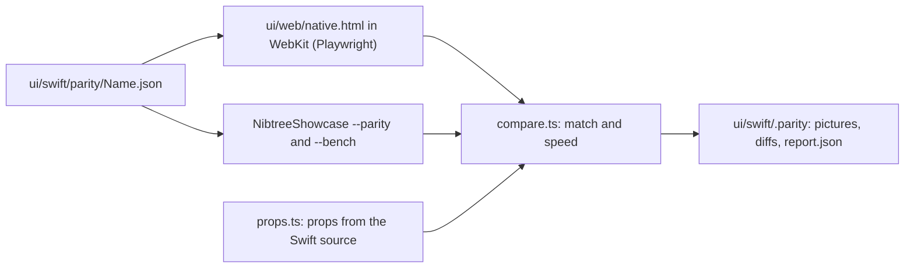

# Swift UI Parity

Every component in `ui/swift` must look like its `ui/web` twin and draw faster. The parity gate checks both for every component, in CI too, so the native app cannot drift from the Tauri app or get slower than it. This page explains the gate and the tricks that make SwiftUI draw like WebKit. The library itself is in [Swift UI Library](Swift-UI-Library.md).

## Why we need it

A component that looks "about right" in a screenshot can still be a pixel off, a weight too bold or a line too tall, and those add up across a screen. A native app that is not faster than the web view has no reason to exist. Both are easy to lose without noticing, so a machine checks them on every change.

## How it works

A scenario is a component tree with props and a width, in `parity/<Name>.json` (a long list splits into `<Name>.<part>.json`, such as `Text.values.json`). `scripts/parity.ts` draws each one in WebKit and with SwiftUI (`ImageRenderer`), in light and dark at 2x, and times both sides. A scenario passes only when all of these hold:

- **Match:** the share of pixels within 24 of 255 per channel, at least 99% twice: at the same spot, and at the same spot or one device pixel away (half a point). A different size fails outright.
- **Speed:** the time to build, lay out and draw 200 copies (`NIBTREE_PARITY_COUNT` changes it), best of 7 runs after 2 warm-ups, on both sides. Swift must be faster.
- **Every prop:** each prop of the component's `init` appears in a scenario, every value of its own enums too (a flag needs `true`), and `ScenarioView.swift` reads it. Shared presets such as `NSpacing` need the prop only; the token tests check their steps. `scripts/parity/props.ts` reads the props from the Swift source, so a new prop without a scenario fails.

Pictures, side by side diffs (web, Swift, differences in magenta) and `report.json` go to `ui/swift/.parity/`; CI keeps them when it fails.

A run takes about a minute and a half. `bun run ui:swift:parity text-body stack-scroll` runs only the scenarios named.

## Text: Core Text, like WebKit

`NText` lays out and draws its text with Core Text, the engine WebKit uses, in a SwiftUI `Canvas` (`NTextEngine`, `NTextCanvas`). That gives the same glyph positions and line breaks as the web app, and it is much cheaper than a SwiftUI `Text` per label. Four details make it match to the pixel:

- **Weights.** The system font is a variable font; CSS weights are exact points on its weight axis (600), where AppKit's named weights sit a little apart (590), so fonts are made at the CSS weight.
- **Line boxes.** A line is WebKit's height (the line height times the size, or the rounded ascent and descent), with the baseline where CSS puts it and on a whole device pixel.
- **Fractions.** SwiftUI rounds a view to device pixels; WebKit draws text at fractional positions. The text's layout sees its exact position and the drawing moves back by what the rounding took away.
- **No font smoothing,** like `-webkit-font-smoothing: antialiased` (`NTypography.matchWebTextRendering()` at launch).

Selectable text keeps a SwiftUI `Text`, which needs a real text view.

## Layout: the same box model

- **Fractions kept.** `NStackLayout` places children at exact fractional points, like flexbox, never rounded.
- **Borders add height.** A stack's `line` adds one point, like a CSS border.
- **Grow.** Children marked `NStackGrows` share the free length (`flex: 1 1 0`).
- **Whole points.** The picture's height is rounded up to whole points, like Playwright's screenshot, which also keeps `ImageRenderer`'s coordinates (measured from the picture's center) on whole device pixels, as a window's are. Without that, text could draw a pixel lower than in a window.

## Speed: fewer views

SwiftUI's cost is mostly the number of views in its graph, so components keep it small: one `Layout` per stack that also does the padding, one canvas per text, colors cached per theme, no environment reads in `NText`, and a scroll view only when the content overflows.

## Where the code lives

| File | What it does |
| --- | --- |
| `ui/swift/parity/*.json` | The scenarios, one file per component |
| `ui/swift/scripts/parity.ts` | Runs both sides and prints the verdicts |
| `ui/swift/scripts/parity/compare.ts` | The match and the verdict |
| `ui/swift/scripts/parity/props.ts` | Reads props from the Swift source and checks they are all tried |
| `ui/web/native.html`, `ui/web/src/native/` | The web side: scenarios and the timing list |
| `ui/swift/Sources/NibtreeShowcase/Parity/` | The Swift side: `--parity`, `--bench`, `ScenarioView` |
| `ui/swift/Sources/NibtreeUI/Theme/NTextEngine.swift` | Core Text layout and drawing |

## Design decisions

**Two match figures.** The one-pixel neighbour rule forgives half-pixel glyph edges; requiring the same-spot figure too means a whole shift of a line still fails.

**Props read from the source.** The prop list comes from each component's `init`, so a new prop fails the gate until a scenario uses it.

**Scroll views on demand.** A scroll stack that fits is a plain stack; it switches to a scroll view when it overflows, and its children start over at that moment.

## Tests

- `ui/swift/scripts/parity/compare.test.ts` (Vitest): the match rule, the verdict and the scenario checks.
- `ui/swift/scripts/parity/props.test.ts` (Vitest): reading props and enum cases, and the coverage problems.
- `Tests/NibtreeUITests/StackTests.swift`: scroll views only on overflow.

## Keeping this page in sync

Update it when the rules, the scenario format or the drawing tricks change.
