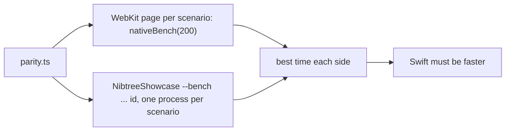

# Swift UI speed

Every Swift component must draw faster than its web twin, and the parity gate checks it on every run (see
[Swift UI parity](Swift-UI-Parity.md)). This page explains where SwiftUI spends its time, what the components do about
it, and how the gate times both sides fairly.

## How the gate times a scenario

Each side builds and lays out 200 copies of the scenario, draws the ones in a 1000 by 800 point window, a few times
after warming up, and keeps its best time.
The web side does it in a fresh WebKit page per scenario. The Swift side runs `NibtreeShowcase --bench` once per
scenario, in its own process, for the same reason (see the bugs below). Both sides are timed back to back, and a
scenario Swift loses is timed twice more, both sides, before it fails.

## Fewer views

SwiftUI's cost is mostly the number of views in its graph, so components keep it small:

- One `Layout` per stack that also does the padding.
- One canvas per text, and one per small component: `NKbd` is one layout and one canvas that draws the key cap and its
  text. A Chip draws a still status mark in its own canvas too; only a spinner is a view of its own.
- Colors cached per theme, and no environment reads in `NText` or `NStack` (a canvas reads the palette while drawing).
- Selectable text is drawn like other text and becomes SwiftUI's selectable `Text` once the pointer is over it: that
  `Text` cost twice the drawn one.
- A scroll view only when the content overflows.
- No `if` in a component's body for an option most uses leave off: each one cost a row of six `NStatusDot`s 3 to
  5 ms. An animation is the caller's modifier too: a running dot is `NStatusDot(...).nibtreePulse()`, so the
  dots that stay still pay neither the branch nor the pulse's state (8% on a row of dots).
- No layout when nothing shows it. A StatusLetter is one canvas in a fixed frame: a row stretches the web's span,
  but it draws nothing there, and dropping the layout made a row of letters 8% faster.
- One `accessibilityRepresentation` (a real `Toggle` for `NSwitch`) instead of five accessibility modifiers: 5%
  faster on a row of switches, and VoiceOver reads a switch.
- A control's words in the control's own canvas. `NCheckbox` with a plain label is one layout and one canvas that
  draws the box and the words; a stack, a box canvas and an `NText` took a column of six checkboxes from 100 ms to
  227 ms, where the web took 164.
- No tooltip inside a component. A web `title` is SwiftUI's own `.help("...")`, added by the caller only when there
  is one: an empty `.help` cost as much as a whole `NMark`. When the tooltip is the component's own (an
  `NIconButton`'s or a StatusIcon's label), it is made only while the pointer is over it (`NHoverHelp`): a `.help` on
  every mark cost a row of them a third of its time.

The frames go further. `NMergeStackFrame` is one layout and one canvas: `NMergeStackGeometry` works out every title
strip, pane and line once, the canvas draws them and the layout places the texts, editors and handles. There are no
stacks or `GeometryReader`s in it (a `GeometryReader` rebuilds its content on every layout and cost three times the
web's time). Handles draw nothing until pointed at, so a frame or split makes them the first time the pointer enters
it and keeps them, or at once when VoiceOver is on. On macOS a split view's divider is not in the Tab order, so the
handles are adjusted with VoiceOver's increment and decrement instead of the web's arrow keys.

## The harness's own cost

The harness turns a scenario's JSON into views (`ScenarioView` and one file per library group in
`Sources/NibtreeShowcase/Parity/Groups`), and every child pays for that too:

- **Short switches.** SwiftUI makes one nested view type of all a `switch`'s cases, and every node pays for its
  depth. `ScenarioView` has one case per library group, and each group's view switches over its own components,
  so adding a component never makes the others slower. The group's switch is drawn straight into `ScenarioView`'s
  (`inner.view`), not through a view of its own: that extra view cost 3 to 5 ms in a row of six dots.
- **Children written out.** A `ForEach` gives every child its own subgraph. `ScenarioChildren` writes up to eight
  children out like a static stack's (a row of eight Spacers drew in 100 ms through `ForEach`, 85 ms written out).

Code in the app is static, like the written-out children, so the gate's Swift times are on the slow side.

## Bugs we fixed

**Stacks, splits and frames failed the speed check.** Twenty-eight scenarios (stacks with several children, splits,
merge frames, text lists) were slower than the web, and only in the full run: alone they passed.

Why: the bench ran every scenario in one process. `icon-every-name` draws every icon 200 times (almost 2 seconds and
about 440 MB), and every scenario after it ran about 1.7 times slower. Draining the autorelease pool per run did not
help: the process stays slower once it has grown.

Fix: `parity.ts` runs the bench once per scenario (`--bench <folder> <count> <warmup> <runs> <id>`), the way the web
side loads a fresh page per scenario, so one heavy scenario cannot hide or cause a failure in another.

**CI failed the speed check while a Mac passed.** On GitHub's runner a third of the scenarios were slower than the
web, and different ones in each run, while every one passed on a Mac.

Why: the gate timed every Swift scenario first and every web one minutes later. A fresh runner indexes the checkout
and the build (Spotlight) in its first minutes, so Swift was timed on a busy machine: the first scenarios twice as
slow as on a Mac, the web side as fast. A loaded Mac flattered Swift the same way the other way round.

Fix: each scenario is timed Swift then web, back to back, so both see the same machine; a loser is timed twice more
before it fails; and the CI speed job turns Spotlight off. CI runs match and speed as two jobs side by side, so the
speed job is not also taking pictures.

**Swift drew copies no one could see.** Why: the bench clips its list to the window, but SwiftUI still records every
copy's drawing; WebKit paints only what is on screen. Fix: copies below the window are `.hidden()` (laid out, not
drawn). `text-sizes` went from 266 to 128 ms.

## Where the code lives

| File | What it does |
| --- | --- |
| `ui/swift/scripts/parity.ts` | Times both sides back to back, one Swift process per scenario |
| `ui/swift/Sources/NibtreeShowcase/Parity/ParityRunner.swift` | `--bench`: copies, warm-ups, best run |
| `ui/swift/Sources/NibtreeShowcase/Parity/ScenarioView.swift` | The group switch and `ScenarioChildren` |
| `ui/web/src/native/` | The web side's timing list (`nativeBench`) |

## Keeping this page in sync

Update it when the timing rules change, or when a finding changes how components or the harness are built.
