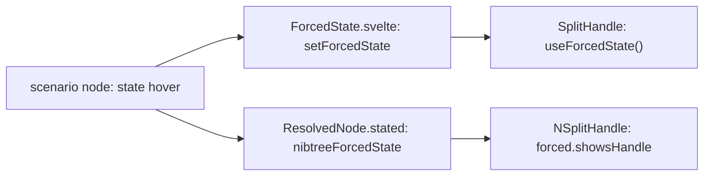

# Swift UI States

A component looks different when it is pointed at, pressed, focused or dragged. These states must match between the web UI library and its Swift twin as much as the resting look does. This page explains how both libraries draw a state on demand, how the compare tool draws every prop value and state of a component at once, and what that found. The tool itself is in [Swift UI Compare](Swift-UI-Compare.md) and the gate in [Swift UI Parity](Swift-UI-Parity.md).

## Why we need it

The parity pictures are drawn off screen, where nothing can be pointed at, so until now a split handle's accent line was never compared. A component also has many prop values, and the saved scenarios try each value once, in one setting. Drawing every value in the same scenario finds differences that only show in combinations.

## Forced states

- A scenario node can carry `state`: `hover`, `pressed`, `focus` or `dragging`.
- On the web, `ScenarioNode.svelte` wraps the node in `ForcedState.svelte`, which sets a Svelte context from `logic/forcedState.ts`. A component reads it with `useForcedState()` and draws the state with the same CSS as the real one.
- In Swift, the harness wraps the node in `.environment(\.nibtreeForcedState, state)` (`NForcedState.swift`), only for nodes with a state, so other nodes cost nothing. Split and merge frames make their handles when a state is forced, since they normally make them on the first hover.
- A component's doc lists the states it draws (`states`), shown in its Markdown doc. The gate asks for a scenario forcing each one and flags a forced state the doc does not list. Keyboard focus on a split handle is web only: a macOS split divider is not in the Tab order.

## All values

The compare tool's **All values** view takes the selected node and makes one scenario per value of each choice or switch prop, plus one per state, then draws them a prop at a time with one Swift run per prop. Each cell shows web, Swift and the differences in light and dark with its match. A required prop (Icon's `name`) gets no "default" cell. A cell that cannot be drawn says why, so one bad cell does not stop the grid.

## What it found

Drawing every value and state of every component (358 cells) found five differences the saved scenarios had missed. All are fixed in the Swift library and saved as scenarios:

- **A stack is as wide as its room.** On the web a Stack is a block, so a row's top line runs the whole width and a centered column centers in its parent. `NStackLayout` now gives a stack the width it is offered, and measures a child it does not stretch at its content's width first (CSS fit-content).
- **A sized pane keeps its size.** A split shorter than its sized pane now lets the handle and the other pane go past the end, like the web's `flex: none` pane, instead of squeezing the pane.
- **A pane with no room shows nothing.** The panes take exactly the room the split gives and clip to it.
- **The test frames.** The web frame is positioned, so a `SplitHandle` lands in it, and the Swift frame is a column stack, so a child's own alignment applies.

The cells still marked are web-only props the Swift Stack does not have yet (`paddingLeft`, `height`, `sticky`), and a growing Stack alone in a frame with no height, which the web draws at no size.

## Where the code lives

| File | What it does |
| --- | --- |
| `ui/web/src/lib/logic/forcedState.ts`, `ui/web/src/native/ForcedState.svelte` | Forced states on the web |
| `ui/swift/Sources/NibtreeUI/Theme/NForcedState.swift` | Forced states in Swift |
| `ui/web/src/native/compare/valueGrid.ts`, `GridPanel.svelte` | The All values grid |
| `ui/swift/scripts/parity/props.ts` (`stateProblems`) | The gate's state check |

## Tests

- `props.test.ts`: `stateProblems` asks for a scenario per listed state, nested nodes included, and flags states a component does not draw.
- `valueGrid.test.ts`: a cell per value and state, no default cell for a required prop, unique ids, only the chosen node changed.
- `SplitMathTests.swift`: a sized pane keeps its size past the split's end.
- The scenarios `*-hover` and `*-dragging` for SplitHandle, ResizeHandle, SplitPane and MergeStackFrame.

## Keeping this page in sync

When a component draws a new state, add it to its doc's `states`, read `useForcedState()` on the web and `nibtreeForcedState` in Swift, and add a scenario per state.
