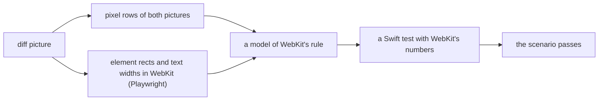

# Swift UI and WebKit's rules

Every Swift component must look like its web twin to at least 99% (see [Swift UI parity](Swift-UI-Parity.md)). The
web twin is drawn by WebKit, so some Swift components copy WebKit's own drawing and layout rules, not just the CSS
they were given. This page lists those rules, how each was found, and where the code lives.

## How a rule is found

When a scenario misses 99%, the parity pictures show where (`ui/swift/.parity/diff`). We then measure the web side
in WebKit itself, never guess:

## The rules

**Dashed rounded borders.** A notice-style EmptyState has a `1px dashed` border with round corners. WebKit strokes the
whole outline in one go: a Core Graphics rounded rectangle (which starts halfway down the right side), 2.2 border
widths wide, dashes three widths long from phase three, clipped to the border's ring. When the dashes would not fit
the outline evenly, each gap grows a little. Drawing each side on its own put the dashes a point off.
`NEmptyState`'s `dashedBox` does what WebKit does.

**Flex shrinking.** When the Navigation Bar is narrow, the crumbs far from the file shorten first (their
`flex-shrink` is 10 to the power of the distance). CSS shares the missing width out by flex-shrink times each item's
*inner* size, its width without padding. Using the whole width left a crumb half a point off. An item never shrinks
below its `min-width`; one whose content is already narrower than that is held there from the start.
`NCrumbMath.widths` does this, and `CrumbMathTests` checks it against WebKit's numbers.

**Growing children keep their content.** A column's growing children (`flex: 1`) share its free height, but CSS
never makes one shorter than its content (`min-height: auto`): a taller one keeps its height and the rest share what
is left. `NStackLayout` gave every grower an even share, so three empty states in a column overlapped. Rows still
share evenly, because a row's children may wrap or cut their words.

**Ellipses keep the first letter.** CSS always shows a cut text's first character, with the ellipsis after it even
when that does not fit; the box then clips the ellipsis. Core Text's own cut drops to a lone ellipsis, so
`NTextEngine` keeps the first character itself.

**Centered lines.** `text-align: center` centers each wrapped line on its own, and a wrapped line's trailing space
hangs outside. `NTextEngine.draw(..., centeredIn:)` does the same for EmptyState's title and hint.

**Fixed bars.** The floating and anchored Navigation Bars are `position: fixed`, placed against the browser window,
which is wider than a scenario's frame. In a scenario, the web adapter puts them in a transformed box over the frame
(a transform makes a box the place fixed children are measured from), and the Swift harness places them with
`ScenarioFixed`. In the app, SwiftUI's caller places them with an overlay.

**Shadows past the box.** A canvas draws only inside its own bounds, so the floating bar's popup shadow is drawn by a
canvas larger than the bar by the shadow's reach.

**Text fields.** An input with no width is as wide as 20 of its font's zeros, plus 2 points for the caret, its
padding and its border; a text area the same, the zeros rounded up to a whole point and no caret. A placeholder is
WebKit's `darkGray` in both themes. `NInputLook` and `NTextAreaLook` follow these, found with Playwright's element
rects.

**Radios and the resize grip.** A radio is 12 points round: a 1.5 point ring in AppKit's secondary label color, or the
accent with a 3.5 point white dot. A text area with `resize: vertical` shows a grip of two 1 point strokes at 45
degrees, 6 points in from the corner, in the same color. Both come from pixel dumps of WebKit's pictures.

**The cascade.** A rule's weight decides, not its place: `:hover:not(:disabled)` outranks `.active`, so a pointed-at
toggle shows the hover color even when on. Equal weights go by order, which can undo a rule: SettingRow's `.row`
padding comes after `.nested` and resets its indent, so neither side indents a nested row.

**Inheritance and margins.** A Text with no tone takes the color it sits in (a disabled row's faint words), so an
`NText` with no tone draws in `nibtreeCurrentColor`. A settings group title keeps room above itself, less as its
stack's first child: `NStackMargin` gives a child a CSS margin with a `:first-child` value.

**Baselines.** A row with `align-items: baseline` lines children up on their first text line. `NText` and `NKbd` report
that baseline to the layouts around them (SwiftUI's `firstTextBaseline`), and a view without one uses its bottom, as
CSS does for an icon.

**File icons.** The app's Material and Minimal file icons are SVG files. AppKit reads SVG itself, so `NFileIcon` draws
the same files into kept bitmaps; a Minimal glyph is a mask filled with its theme color, like the web's CSS mask.

## Bugs we fixed

**Three empty states in a column overlapped.** Each one took an even share of the column, so the tallest (a big
check) spilled into the next. Why: `NStackLayout` ignored CSS's `min-height: auto`. Fix: a growing column child
keeps at least its content's height and the others share the rest, as CSS does; rows were left alone because their
children may shrink by wrapping.

## Where the code lives

| File | What it does |
| --- | --- |
| `ui/swift/Sources/NibtreeUI/Logic/NCrumbMath.swift` | Flex shrinking with min widths |
| `ui/swift/Sources/NibtreeUI/Layout/NStackLayout.swift` | Growing children's shares |
| `ui/swift/Sources/NibtreeUI/Theme/NTextEngine.swift` | Ellipses and centered lines |
| `ui/swift/Sources/NibtreeUI/Components/NEmptyState.swift` | The dashed box |
| `ui/swift/Sources/NibtreeUI/Layout/NFileIconImages.swift` | SVG file icons into bitmaps |
| `ui/swift/Sources/NibtreeUI/Layout/NInputLook.swift`, `NTextAreaLook.swift` | Text field sizes and the grip |
| `ui/swift/Sources/NibtreeUI/Theme/NWebKitColors.swift` | WebKit's control colors and the placeholder |
| `ui/web/src/native/adapters/` | Web adapters, such as the fixed bars' box |

## Keeping this page in sync

Add a rule here when a component copies something WebKit does on its own, with how it was measured. Keep a test
with WebKit's numbers for each rule that is math.
